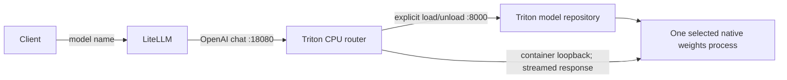

# WORD_GAMES models through Triton and LiteLLM

Deployment status: the three new checkpoints and Triton packages are installed
and validated. Registration of their new LiteLLM aliases has been requested from
201-1002 and is awaiting confirmation. The existing Empero alias remains registered.
Direct native chat and the local lifecycle commands are available now.

The catalog uses the existing `triton` container and model repository. A CPU-only
Triton model, `word-games-model-router`, exposes OpenAI chat on the existing trusted
ZeroTier endpoint `http://10.158.218.141:18080/v1`. It selects a native model using
the request's `model` field and calls Triton's explicit load/unload API.

| LiteLLM model name | Triton weights model | Checkpoint | GGUF bytes |
| --- | --- | --- | ---: |
| `qwen3.6-35b-a3b-hauhau` | `word-games-hauhau` | HauhauCS Qwen3.6-35B-A3B Aggressive, Q4_K_M | 21,166,758,016 |
| `dolphin-x1-trinity-nano` | `word-games-dolphin` | Dolphin X1 Trinity Nano, publisher Q5_K_M | 4,384,985,600 |
| `orion-26b-a4b` | `word-games-orion` | TheDrummer Orion-26B-A4B-v1.1, bartowski Q4_K_M | 17,966,167,008 |
| `qwen3.8-35b-a3b` | `word-games-qwen38-native` | Existing Empero Qwen3.8, Q4_K_M | 21,713,462,944 |

The existing Empero upstream alias is `word-games-empero-qwen38-35b-a3b`.
The three new upstream aliases equal their LiteLLM names. Source repositories,
revision hashes, file sizes, SHA-256 hashes and local paths are in
[`fleet/catalog.json`](fleet/catalog.json). Gateway configuration is in
[`fleet/litellm-routes.yaml`](fleet/litellm-routes.yaml).

## Selection and GPU memory



Only one catalog model occupies GPU memory at a time. The router waits for an
active response, including its entire SSE stream, before switching. A client
which disconnects does not release the lease until the upstream response is
drained. Repeated requests for the resident model reuse its loaded weights.
Unknown model names are rejected before any GPU changes; failed loads return an
error and never use another model as a fallback. A process lock additionally
rejects overlapping direct Triton loads of catalog models.

Dolphin uses the RTX 2060 SUPER. HauHau, Orion and Empero use whole-layer placement
across the three reserved GPUs. Each native worker retains the patched llama.cpp
runtime, GPU expert processing, Flash Attention, Q8_0 K/V, an 8,192-token shared
input/output context, one generation slot, and disabled speculative decoding.
The GGUF's own chat template is used for each architecture. These routes are
text-only; tool calling and vision are not advertised.

The router is lifecycle glue added by this deployment. LiteLLM itself does not
load Triton models or reserve GPUs. The user's open-ended reservation of the three
GPUs remains in force until released; unloading weights does not relinquish that
reservation or restore infrastructure's LLM/OCR workloads.

## Usage

Use the existing LiteLLM API at `https://10.158.218.193:4000/v1` with the usual API
key and choose one of the table's model names. Default output is capped at 1,024
tokens. Cold selection loads weights before the response starts; allow up to 600
seconds. Warm requests skip loading. Concurrent generations are serialized.

From the repository root:

```bash
# Preload a particular model; ordinary LiteLLM inference also selects it.
pixi run word-games-load dolphin-x1-trinity-nano
pixi run word-games-load qwen3.6-35b-a3b-hauhau
pixi run word-games-load orion-26b-a4b

# No argument preserves the original Empero default.
pixi run word-games-load
pixi run word-games-status

# Release weights; the router remains ready to load a later request.
pixi run word-games-unload

# Drain and unload weights, then stop the router's HTTP endpoint.
pixi run word-games-down

# Verify installed file hashes and checkpoint identities.
pixi run word-games-verify
```

These commands never restart the shared Triton container. After a container
restart, the CPU router must be loaded before LiteLLM can reach it. Running
`pixi run python -m experiments.word_games_triton.fleet start` loads the router
without loading GPU weights. `word-games-status` is read-only and never restarts
a stopped router.
Infrastructure can persist that startup behavior with
`--load-model=word-games-model-router` alongside `--model-control-mode=explicit`.
Do not automatically load the four GPU models at boot.

The router's management contract is available only through normal Triton inference:
`POST /v2/models/word-games-model-router/infer`, a BYTES input named `control`
containing `{"action":"status"}`, `{"action":"unload"}`, or
`{"action":"load","model":"<upstream alias>"}`. The public chat endpoint exposes
only `GET /v1/models` and `POST /v1/chat/completions`. Native `/slots`, `/props`,
`/completion` and other management paths stay private on container loopback.

## Installation and reproduction

Checkpoints live on `/data/models`, mounted read-only as `/model-weights` inside
Triton. Installed packages live under `/data/models/_triton`, mounted read-only
as `/models`. Packages contain their pinned native executable, CUDA libraries
and isolated sysroot; no research checkout is mounted into Triton.

```bash
pixi run python -m experiments.word_games_triton.download_catalog \
  --receipt data/experiments/word_games/<fresh-run>/downloads.json
pixi run word-games-install
```

The downloader checks destination space, resumes `.part` files, pins revisions,
verifies complete SHA-256 hashes, and only then renames each completed file.
The selected downloads total 43.5 GB; reserve at least 50 GB including runtime packages.
The rejected community Dolphin Q4 file is retained as a diagnostic artifact (3.8 GB).
Checksum reads are serialized for the rotational data disk. Installation refuses
to replace a loaded model, stages outside the model repository, and records all
installed file hashes in each model's `installation.json`. Unload the router
with `word-games-down` before reinstalling all entries.

`regular/release.lock.json` continues to pin the native runtime assets and Empero
legacy backend. `fleet.py` is the current installer and lifecycle controller;
the older regular and standalone installers are retained for reproduction.
The Empero `text_input`/`sampling_parameters` Triton contract remains available.
The additional models provide the same JSON research contract using their own
native templates. The router adds normal chat, history and streaming independently.

The live Compose configuration exposes GPU device IDs `[1,0,2]` and publishes
port 18080 only on `10.158.218.141`. Infrastructure owns the canonical Compose
configuration and shared `triton.service`; retain the GPU and chat-port changes
in `regular/triton-gpu-visibility.patch` and `regular/triton-chat-port.patch`
when rebuilding it.

## Validation

The new deployment evidence is under
`data/experiments/word_games/20261103_model_fleet_v1/`. Checks cover checkpoint
integrity, model identity, chat history, JSON, SSE with usage, direct Triton
inference, memory while loaded, and GPU release on unload. These are deployment
checks, not task-quality, refusal-rate or WORD_GAMES V3/V4 certification. The
older approximately 67 tok/s result applies only to the previous Empero workload.

```bash
pixi run python -m experiments.word_games_triton.validate_fleet \
  dolphin-x1-trinity-nano --output data/experiments/word_games/<fresh-run>/native
pixi run python -m experiments.word_games_triton.check_chat_route \
  --model dolphin-x1-trinity-nano --output data/experiments/word_games/<fresh-run>/gateway
```

Dolphin uses the publisher’s Q5_K_M because the community Q4_K_M produced repetitive,
incorrect output even with FP16 KV. It gives coherent answers with the publisher
checkpoint, but may add explanatory text despite one-word/two-word instructions.
Its deployment check uses `--allow-explanatory-text` and retains separate
`exact_format_passed` fields; this is not a claim of exact instruction compliance.
