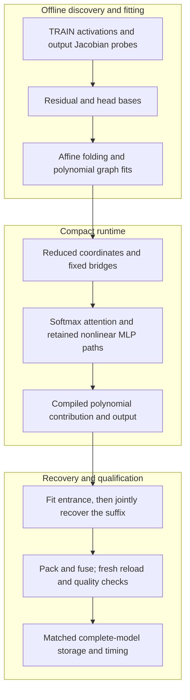

# Residual compression and recovery: implemented design

**Status:** implemented research architecture with separately identified proposals

**As of:** 2026-11-15

**Applies to:** J-space experiments on Qwen2.5-3B-Instruct; Phi remains a separate pilot

The implemented path now goes beyond the earlier
[concept/Krylov proposal](concept-krylov-attention-compression.md): functional
bases, affine coordinate folding, polynomial MLP substitution, recovery and
packed execution all have executable implementations and measured results.
Useful local compression and substantial development recovery are established.
Recovery of a complete, generally useful compressed model is still open.
The [implementation guide](../../02%20-%20Implementation/jspace-compression-and-recovery.md)
describes the executable interfaces; the
[evidence synthesis](../../08%20-%20Analysis/jspace/2026-11-15_compression-evidence-synthesis.md)
compares the experiments and their source receipts.

## Objective and retained computation

The governing [residual-compression direction](../../07%20-%20Status%20Reports/jspace/2026-11-13_jspace-residual-compression-direction.md)
is to replace a useful covered contribution with cheaper computation while
retaining the pathways needed for the combined model:

`F_hat(x) = C_B(x) + R_B(x)`



This is a design sequence, not a claim that every historical run used every
stage. The branches may exchange context; autonomous closure or replacement of
an entire layer by the covered branch is not required. Conversely, evaluating
the original operation to obtain an exact residual would erase the intended
saving. Which original operators are removed, which remain, and the cost of
their merge must be explicit.

“All 36 blocks compressed” means applying the chosen intervention at every
block. It does not mean eliminating every native operation: softmax, retained
MLP channels, and the tied embedding/readout can remain. Extending the current
suffix across all blocks is compatible with this retained-computation goal.

## Functional coordinates and folding are implemented

Task-Jacobian directions select coordinates by measured sensitivity of a
declared output to a local activation. Early studies used correct-option
margin gradients; later calibration uses two groups of random-sign
full-vocabulary vector-Jacobian probes at specified token positions. These are
different estimators and supervision scopes. Their trace-retention percentages
are neither directly interchangeable nor finite-perturbation error bounds.
The [final-block study](../../08%20-%20Analysis/jspace/2026-11-13_jspace-qwen-affine-v2.md)
reports independent probe-group retention as well as fitted retention.

The compact affine block represents a native-width column state as
`h ≈ a_p + U z`, with `z = U.T @ h`, an orthonormal basis `U`, and training-derived
position anchor `a_p = mean_p - U @ U.T @ mean_p`. The fixed affine background
survives; it replaces the sample-specific component outside `U` rather than
retaining that component exactly. RMS gains and incoming/outgoing
projections are folded into the smaller weights. The RMS denominator uses
`sqrt((||z||² + ||a_p||²)/native_width + eps)`, preserving the original width.
These algebraic identities are exact for the represented affine state in real
arithmetic; reducing rank remains an approximation to the original network.

Head compression selects complete Q/K RoPE frequency pairs, shares their
selection within each GQA group, projects values, and folds the value/output
maps. Original score scaling, causal token coverage and softmax remain.
The current rank-1024/head-64 suffix uses polynomial **MLP** relations; this
does not turn its attention into polynomial or quadratic attention.
Implementation: [AffineQwenBlock](../../../experiments/structure_net/jspace_qwen_affine_block.py).

Adjacent affine blocks use fixed bridges, with weight `U_next.T @ U_current`
and the corresponding projected anchor difference. The stack encodes once,
passes reduced coordinates between blocks, and reconstructs native width at
its exit. Bridge equivalence to decode/re-encode is an algebraic interface
property, not a guarantee that repeated affine projections preserve accuracy.
Implementation: [CompactQwenStack](../../../experiments/structure_net/jspace_qwen_compact_stack.py).

Keep this architecture distinct from the historical
[full residual-carry branch](../../../experiments/structure_net/jspace_residual_carry.py).
That branch returns `h + U(z_out-z_in)` and carries the actual omitted input
component and its energy forward. Its incoming numerators still use fixed
mean approximations; it does not restore the omitted dynamic computation.
Its isolated/full-head recovery results cannot be assigned to the current
affine half-head polynomial suffix as if they were the same model.

## Polynomial relations remove work, with an empirical defect

The implemented MLP compiler selects physical anchor channels, standardizes
their activations using TRAIN statistics, and fits degree-at-most-two maps
for selected other SwiGLU channels. It compiles graph relations
`g_i = y_i - p_i(z)`. For the declared rational coefficients and elimination
order, distinct monic leading variables establish the Gröbner product
criterion. This certifies the fitted graph surrogate's algebra.

It does **not** establish an exact global ideal of the neural activations.
An arbitrary finite-sample polynomial fit has graph relations of this form;
the useful empirical content is small held-out neural defect, reuse across
tasks, and a cheaper combined model. With free anchors the quotient remains
infinite-dimensional. The chosen degree-two feature library is a bounded
slice, not proven closure or a discovered finite-dimensional quotient.
Semantic CAV identification also does not follow from a task-sensitive basis
or from common-fit reconstruction counts.

The exact accounting identity is:

```text
W a = W_keep a_keep + W_removed p(z) + W_removed [a_removed - p(z)]
```

The implementation deletes the selected gate/up channel computations, retains
uncovered nonlinear channels, and folds or packs the polynomial output into
the down projection. It omits the final covered-channel defect term; retained
channels are not an exact correction for it. For the common 1,024-removal
recipe, 9,984 of 11,008 native nonlinear channels remain. A fixed removal
budget is not proof that every removed channel passes a cross-task threshold.
Recovery subsequently learns compiled output coefficients, so an initialization
certificate must not be described as an exact certificate of adapted neural
behavior. See the [compiler](../../../experiments/structure_net/jspace_groebner_tensor.py)
and [measured substitution study](../../08%20-%20Analysis/jspace/2026-11-13_jspace-bench-tensor.md).

No symbolic reduction runs per token. The numerical coefficient arrays and
retained pathways are the inference artifact. Relations among anchors,
ideal-derived tensor splits, semantic concept discovery and Krylov/operator
closure remain proposals rather than prerequisites for this implemented path.

## Recovery must address composed student inputs

Single-layer fitting is useful because it separates basis quality, fitting
error and interface errors while the rest of the model supplies a stable
context. The historical enriched first-block experiment reached 48/64 versus
native 50/64. Its parallel extension produced 32 isolated passes among 34
newly fitted blocks, yet the all-compact assembly reached only 27/64.
See [single-layer learning](../../08%20-%20Analysis/jspace/2026-11-14_qwen-compression-learnings.md)
and [assembly evidence](../../08%20-%20Analysis/jspace/2026-11-14_qwen-recovered-assembly-results.md).

A design hypothesis is distribution mismatch and interacting errors:
independent fits see native input states; later assembled layers receive
states changed by earlier compact layers. A small average local MSE can miss
task-sensitive directions, and good isolated answer counts need not preserve
the same answers. These mechanisms motivate recovery on current student
activations; the observed failure does not identify a unique causal mixture.
Even the teacher-guided projection trajectory that preserved 64/64 native
decisions received native targets at every layer. It demonstrates that those
decisions are compatible with the tested subspaces on those cases, not that
the learned blocks can produce the required updates unaided.

The implemented progressive remedy grows an accepted suffix one block at a
time. It calibrates the new block against the actual recovered parent, fits
the entrance interface while inherited blocks are frozen, then jointly
updates the entire compressed suffix and final norm. The native prefix may
be supplied by authenticated boundary caches, but the trainable suffix is
recomputed on its own current activations. Geometry and bridges stay fixed.
Checkpoint selection follows actual combined task accuracy against the
original-native budget, with the initializer and parent retained as explicit
candidates/fallbacks. The allowance does not accumulate separately per layer.

Parent-feature recovery adds supervision of the accepted parent's actual
post-block-35 compact answer coordinates before native-width exit reconstruction. It helps
constrain the inherited interface while output KD/CE supplies the endpoint
objective. Projected native final states are not interchangeable targets:
the [coordinate audit](../../08%20-%20Analysis/jspace/2026-11-15_qwen3b-native-feature-coordinate-audit.md)
found a substantial representation difference without an indexing or
normalization bug. Earlier continuations calibrated the feature weight per
stage; the expanded-data 15→36 protocol freezes its declared coefficient.
Read the [current progressive protocol](../../07%20-%20Status%20Reports/jspace/2026-11-15_qwen3b-progressive-to-full.md)
for the actual recipe, rather than combining constants from older studies.

Joint recovery is also implemented for all 36 blocks at once. Its current
experiment has different initialization, depth, inherited fits and optimizer
execution, and no parent-feature term. Comparison with progressive recovery
therefore cannot isolate the effect of training order or the feature loss.
Falling loss alone is insufficient: earlier joint runs improved KL/CE while
task answers deteriorated. Packed checkpoint replay validates execution;
it is not independent confirmation of task quality.

## Positive results and the present boundary

| Scope | Observed evidence | Design implication |
| --- | --- | --- |
| Final block, packed fast implementation | Fresh 391/512 versus native 393/512; paired isolated-block 1.297× prefill and 1.275× decode speed | Useful local quality/cost tradeoff is demonstrated at this boundary. The other 35 blocks remain native. |
| Fourteen-block broad recovery | DEV 173→189/256; later audit 93/128 versus native 103/128; six generation canaries collapsed | Recovery improved the selected task distribution, but did not qualify general capability. |
| Verified fifteen-block suffix | DEV 189/256 versus native 195/256 after 288 joint updates | A deeper compressed suffix preserves much of measured DEV accuracy. No new held-out or generation result follows. |
| Independent all-36 experiment, interim | Initial 103/256; update 72 at 109/256 | An early gain at a different depth, still far below the native reference; not a completed recovery result. |

The first row comes from the
[compact performance study](../../08%20-%20Analysis/jspace/2026-11-13_jspace-compact-performance.md):
whole-model graph throughput remained around 41 tokens/s, without a substantial
gain. The later rows have their provenance in the evidence synthesis and
[broad-recovery report](../../08%20-%20Analysis/jspace/2026-11-15_qwen3b-broad-recovery.md).
The 15-block and all-36 scores must not be plotted as successive improvements
of one fixed-depth model or treated as a controlled method comparison.

At this documentation snapshot, the user's active direction is Qwen 15→36.
Phi is paused by the user after a native-only 58/64 pilot; no Phi compressed
recovery result is established. This coordination state supersedes the older
launch-status paragraph in the progressive protocol, without rewriting it.

## Packing and remaining qualification

Packing combines gate/up projections, lays out retained and polynomial
activations contiguously, folds offsets, strips unused intermediate geometry,
and permits fused pointwise kernels and CUDA-graph replay. These operations
have measured local benefits. Count their padding, geometry, residual paths,
cache and tied readout; a block delta is not a standalone model. Kernel gains,
training throughput, and storage reductions are separate measurements.
Generic graph replay also accelerates native execution and cannot all be
credited to compression.

The remaining decisions are empirical rather than missing algebraic promises:

- Qualify every newly composed depth with the original-native budget, retained
  failures and exact fresh checkpoint replay; then use independently specified
  confirmation for the final frozen candidate. Reused DEV is selection data.
- Restore and measure multi-token generation. The current sparse targets cover
  four positions per multiple-choice prompt, without assistant continuation
  or EOS targets. The [complete-response distillation implementation](../../02%20-%20Implementation/distillation-recovery.md)
  exists and has CPU systems evidence, but has not recovered the actual 3B model.
- Test longer contexts and outputs under explicit position/cache semantics.
  Existing anchor tables and measurements are bounded; extrapolating beyond
  their supported length is a new representation/runtime intervention.
- Benchmark the selected exported model against an equally optimized native
  baseline at matched precision, hardware, shapes and cache policy. Include
  native prefix cost when only a suffix is compressed.
- Separate the effects of geometry, relations, recovery and kernels with
  matched controls before assigning a mechanism-specific advantage.

The supported research direction is therefore concrete: retain useful
computation, remove a measured covered contribution, recover the composed
student, and assess the complete model. Local successes justify extension;
they do not remove the need to qualify each larger scope.
