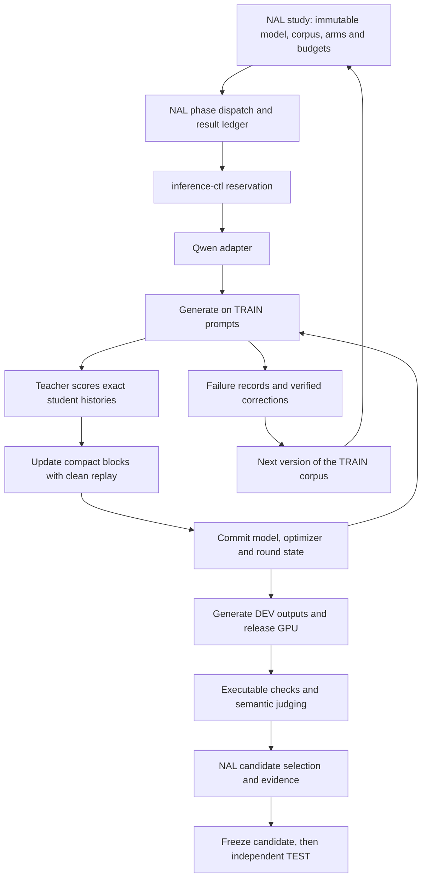

# Plan: adaptive compression recovery through NAL

Date: 2026-11-16. Status: implementation plan; no new recovery arm launched.
Initial scope: the existing three-block Qwen2.5-3B student. The user requested
starting with three blocks; the proposed all36 follow-up remains deferred.

## Outcome and architecture

NAL should own the study, phase dependencies, data lineage, budgets, checkpoint
selection and evidence. The Qwen adapter should own model construction and
memory-efficient numerical execution. The infrastructure reservation controller
continues to own physical GPU allocation. Use the existing NAL runner and result
ledger; do not create another generic scheduler or experiment registry.

The first scientific question is whether teacher feedback on student-generated
histories, mixed with clean replay, improves useful completed answers beyond
continued reference-prefix distillation at comparable supervision budgets.
Failure-targeted supervised corrections are supported by the architecture but
are a separately declared intervention, not an unnoticed change to that test.

## Reuse and concrete gaps

| Existing component | Reuse | Required extension |
| --- | --- | --- |
| `core.Hypothesis`, `Experiment`, `ExperimentResult`; `lab.register_hypothesis` | Register the research question and publish arm/seed results | Explicit phase/round identity and parent artifact references in experiment parameters |
| `RecoveryStudy`, `RecoveryArm`, fingerprints and `paired_gates` in `distillation_recovery.py` | Freeze teacher, initializer, geometry, objectives, corpus and evidence rules | Versioned phase-aware lifecycle; current `RecoveryWorker` is monolithic and expects final quality in one invocation |
| `AsyncExperimentRunner`, `ExperimentResultLedger` | Dispatch, process isolation and completed-result storage | Authenticate consumed artifacts before adoption; ledger reuse alone is insufficient |
| `ResponseRecord`, `SplitGuard`, `response_batch` | Source grouping, token identities and complete response masks | Accepted EOS set, derivative lineage and explicit split retirement |
| `target_contract`, `TeacherTargetStore` | Bind targets to exact predicting positions and prefixes | Generalize the existing Qwen hidden-state cache under the same provenance contract |
| `chunked_backward`, loss functions, rollout/repetition helpers | Exact full-vocabulary loss and bounded generation | Mixed record types, refreshed rounds, declared sampling and global staleness accounting |
| Qwen `ResponseTrainer`, structural restore and packed export/reload | Working compact-suffix execution and original-prefix generation | Persistent session adapter and round-qualified sample identities |
| `CPUGradientAdamW` / `StreamingCPUAdamW.save_checkpoint/load_checkpoint` | BF16 live weights with CPU FP32 masters/moments and chunked persistence | Composite model/optimizer/RNG/cursor checkpoint, with parameter names as well as shapes/order |
| Existing canaries, code/math checks and semantic judge | Actual task evidence | Pending/unavailable judgments, paired candidate records and explicit promotion status |

Do not replace the working optimizer with generic GPU Adam. NAL's generic
`DistillationTrainer` currently calls `state_dict()`, requires an empty optimizer,
and inspects resident `.grad`; the CPU-offloaded optimizer deliberately uses
chunked checkpoint APIs and clears GPU gradients through hooks. Reuse NAL's
loss/data primitives behind the qualified Qwen execution path.

## Contracts to add

### Study and execution phases

Add an immutable recovery campaign specification around the existing study/arm
types. An arm/seed is the scientific unit. Its phases are authenticated child
`Experiment`s: admission, discarded pilot, rollout collection, teacher scoring,
training, candidate generation, grading and finalization. A small fixed recovery
workflow resolves dependencies and submits phases to the existing runner; it is
not an extensible DAG scheduling service.

Each resolved phase binds parent phase fingerprints and actual artifact hashes,
source revision, backend, precision, corpus version, budget and resource profile.
Unknown future checkpoint hashes are resolved and frozen before the consuming
phase starts. Preparation and evaluation phases can complete with zero training
updates; they must not be forced through v1's positive-update scientific gate.
Only the final arm aggregator combines authenticated phase receipts into a
scientific verdict. Add this as a versioned lifecycle beside v1 rather than
loosening or retroactively reclassifying old receipts.

Start with one logical GPU slot, explicit worker injection, `auto_balance=False`
and no automatic whole-training retries. Disable runner-level unverified
completion shortcuts; use authenticated phase readback. A failed partial attempt
is preserved. Resume is a distinct transition from a committed checkpoint.

### Data and failures

Keep immutable corpus versions with example ID, source group, derivative ancestry,
task/failure family, split, source hash and tokenizer/template identity. The
training worker receives TRAIN manifests only. DEV is available to evaluation;
sealed TEST is accessible only in the final confirmation phase after selection.
Splitting applies to calibration and geometry fitting as well as gradients.

Add `FailureRecord` containing the producing checkpoint, source example/group,
raw output reference, detector/verifier versions, failure tags, supporting
evidence and correction status. Repetition and number-span heuristics nominate
examples; executable or semantic verification establishes the relevant failure.
Verified corrections become new `ResponseRecord`s with parent lineage. Raw
mistakes are retained as diagnostic artifacts, not silently made positive targets.

Moving exposed DEV material into TRAIN creates a new corpus plus an append-only
retirement receipt for the entire derivative group. Historical metrics retain
their original membership. No automatic mining of DEV/TEST failures for gradients.
For the initial comparison, keep today's DEV unchanged and mine TRAIN or new
independently sourced training material. Admit fresh confirmation data before
the next adaptation campaign and do not repeatedly replace tests after failure.

### Rollouts and targets

`RolloutRound` records actual generating checkpoint and update, exact token IDs,
TRAIN population, execution backend/precision, tokenizer/template, decoding,
explicit generator seed/state, EOS settings, finish reason and round identity.
Support both Qwen EOS IDs,151645 and151643, while recording the actual observed
terminal ID. Token-cap termination never appends an invented EOS. Reject tokens
after either accepted EOS and distinguish EOS used for padding from response EOS.

The current collector is greedy. Add separately tested seeded categorical
sampling for a stochastic student-policy arm; record temperature and any
filtering. Greedy generation remains the deployment evaluation default. Do not
describe a seed-only greedy implementation as stochastic sampling.

The original frozen teacher scores every selected position on the student's
exact histories. The three-block student also needs original cut33 boundary
activations for those exact histories. Capture both boundary and normalized
teacher hidden rows, then reconstruct logits with the original tied vocabulary
matrix. Existing reference-prefix banks are reusable only for unchanged token
histories. Pin readout/normalization identities; verify cached versus direct
teacher output on actual generated prefixes. Hash immutable shards once, then
track file identities, with provenance checks on every consumption.

Avoid full-vocabulary disk caches by default:100,000 FP32 rows at151,936 entries
cost60.8GB before metadata. The exact hidden/readout representation already used
by this project is the first backend; top-k/tail caching remains a separately
labelled approximation. Bound open shards and resident batches; do not collect
the whole corpus in RAM or copy existing activation banks.

### Persistent training session and resume

Add a session adapter that preserves the same optimizer across rollout refreshes
and accepts declared clean-response and rollout records in the same schedule.
Reuse the current token-weighted, chunked backward and CPU gradient accounting.
For teacher-feedback rollouts, CE on sampled tokens is zero. Any hard-target CE
must consume a separately verified correction record under a declared arm.

Use stable `(corpus_version, round_id, example_id, presentation_id)` consumption
identities; integer dataset indices cannot safely distinguish new rounds and
intentional replay. Keep global token/update counters and age rollouts against
the generating update, not a reset per-trainer counter. The first pilot should
refresh before each optimizer window; a later bounded-stale mode is explicit.

At an optimizer-window boundary, commit model state, fixed-state identities,
CPU Adam chunks, named parameter order, scheduler state, cumulative counts,
sampler cursor, mixture/round state, rollout and teacher-shard hashes, and Python,
NumPy, Torch CPU/CUDA and explicit-generator RNG states. Write the completion
manifest last. Do not checkpoint half-accumulated gradients in the first version.
Keep the current optimizer and previous committed checkpoint until the new one
is authenticated; retain selected model-only snapshots separately. Expose disk
usage and checkpoint latency so persistence does not dominate useful training.

An interruption restores the last complete boundary and its exact next sample;
unfinished work after it can be replayed, with physical work counted separately
from committed scientific updates. NAL's existing completed-result reuse is
not a substitute for this model/optimizer resume contract.

### Evaluation and promotion

Represent execution (`completed`/`failed`), judgment
(`pending`/`available`/`unavailable`), task outcome (`true`/`false`/`null`) and
eligibility separately. A judge timeout preserves training and raw outputs,
prevents promotion, and permits an authenticated grading retry without retraining.
Do not encode missing evidence as zero accuracy. A completed failed-quality
experiment is still a completed execution with an explicit quality verdict.

Use useful completed tasks (`task_success && generation_success`) as the primary
selection metric; report natural EOS, repetition, correctness, numerical fidelity
and per-family outcomes separately. Retain native/initializer/candidate paired
outputs, generation settings, checker/judge versions and counts. Keep the5pp
overall/10pp-per-family MC retention checks, and distinguish relative retention
from absolute application usefulness. Small screens are exploratory.

Recovery may start from the best observed unqualified checkpoint when its
execution is sound; requiring already-good generation would prevent recovery
of the failure it is meant to fix. Preserve that qualification explicitly.
Final TEST requires frozen selection and the declared independent corpus.
Confirmation seed counts must be backed by completed authenticated runs, not
merely the number of seeds listed in a specification. The existing conservative
paired interval is one supported rule, not an automatic requirement for pilot
sample sizes; freeze any alternative before observing its confirmation results.

## Reservation and memory execution

CPU preparation, failure analysis, grading and waiting have CUDA hidden and hold
no GPU lease. For a GPU phase, the launcher obtains `inference-ctl lease run`
before constructing the NAL GPU runner; NAL then uses logical device0 and checks
the live lease throughout. Its free-memory slot planner does not grant ownership.
Release the GPU before waiting for external judges. Retry resource/network
admission only before a producer starts, never partially executed training.

First reuse the measured plain2060 profile:3584MiB reservation,3328MiB allocator
cap, packed Torch on Turing, BF16 live weights and CPU FP32 optimizer state.
Qualify the new rollout/teacher phases separately; current training fit does not
prove they fit. Stream original native layers or alternate teacher/student
residency rather than loading both full models together. Do not retain a live
training model while creating a second packed GPU clone. Include transfer,
generation, teacher-scoring, training, checkpoint and judge time separately.

All GPU work uses locked/offline Pixi and reservation-backed launch. Preserve
the existing progressive and ABLATION32 studies. New source additions must not
change files pinned by running producers. If shared-module edits are necessary,
implement in an isolated checkout from a recorded revision and qualified source
snapshot; leave unrelated working-tree changes intact.

## Implementation sequence and acceptance

| Step | Deliverable and proposed ownership | Acceptance |
| --- | --- | --- |
| 1. NAL admission and phase model | Versioned additions in `src/neural_architecture_lab/distillation_campaign.py`; thin CLI in `experiments/neural_architecture_lab/recovery_campaign.py` | Register/import existing StageA artifacts with honest lineage; canonical fingerprints, dependency resolution and completed phase adoption do not rerun work |
| 2. Failure and corpus contracts | `distillation_failures.py`, using `distillation_data.py` primitives | Group leakage/retirement tests; verified corrections; unchanged historical manifests; TEST inaccessible to training |
| 3. Round/session adapter | `distillation_rounds.py` plus one `experiments/structure_net/jspace_3b_nal_recovery.py` backend | Mixed-token loss/gradient parity; both EOS IDs; actual generating-state identity; no imitation CE on raw mistakes; full optimizer/RNG/cursor resume parity |
| 4. Evidence lifecycle | `distillation_evaluation.py`, reusing existing task/judge functions and gates | Missing judgments stay unavailable; fresh packed reload; primary useful-completion ranking; independent confirmation and actual seed evidence |
| 5. Systems qualification | Tiny CPU round lifecycle, then discarded real three-block CUDA pilot | Refresh, update, interruption/resume, exact teacher-prefix scoring, finite gradients and BF16 block changes; teacher/geometry fixed; reservation loss handled |
| 6. Scientific comparison | Two NAL arms from one generation-selected StageA checkpoint | Reference continuation versus clean replay + student-prefix KD; same teacher/geometry/prompt strata and declared token budget; all retained candidates evaluated |

Steps2 and3 can proceed in parallel once the phase/data interfaces are frozen;
step4 can use fixture receipts concurrently. One integration owner runs the
real pilot and reservation-backed comparison. Prefer these bounded work packages
to more model-specific controllers. No full generic training-framework rewrite.

The first comparison remains at three compressed blocks and416 total positions.
Provisional pilot ceiling:256 student prompts at32 output tokens, then256 fresh
prompts at64 only under a frozen improvement rule, at most24,576 rollout tokens
plus comparable clean replay. Use small refresh windows within each tranche,
not one stale256-prompt batch consumed over many updates. Declare whole-example
budget accounting and unused allocations; ordinary early EOS may reduce totals.
The control receives the same actual supervision budget, with independent clean
examples or explicitly counted replay. Report compute separately because new
prefix generation/scoring is more expensive than cached reference training.

Only after generation evidence supports expansion should a new campaign increase
data budget, compression depth or context length. Longer2048/6300-token inputs
need separate geometry/length validation. Do not launch another all36 recovery
as part of this integration.

## Completion criteria

The architecture is ready when a NAL campaign can complete two refreshed rounds
on the actual three-block model, survive an interrupted/resumed optimizer window,
grade generated outputs independently, adopt completed artifacts without
retraining, and show one traceable report from corpus/checkpoint to verdict and
resource use. This is an integration result; useful recovery and deployment
speed/size remain separately measured scientific outcomes.

References: [existing implementation guide](distillation-recovery.md),
[adopted standard](../05%20-%20Standards/NAL-STD-DISTILLATION-v1.md),
[recovery research](../08%20-%20Analysis/jspace/2026-11-16_recovery-failure-mining-and-holdouts.md).
