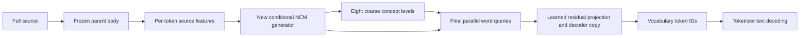

# NCM adaptation with a direct vocabulary-token final level

Prototype: `experiments/structure_net/ncm_word_final_head.py`.
Status: small CPU mechanism tests passed; no task training or accuracy result.

The completed oracle semantic audit found 8/64 complete-summary passes for the
released codec and 6/64 for the EMA-adapted codec, against 63/64 Terra and 64/64
Sonnet passes for the uncompressed targets. The separate 2,048-update
decoder-only control preserved every target code but reached 95.120% token
recovery, versus released 95.179%; it failed its representation gate. These
results motivate changing the final output representation instead of extending
either completed codec run. They do not establish that every NCM codec or
every possible predicted code sequence has the same quality ceiling.

The new prototype retains the original learned coarse hierarchy and level mask,
then predicts vocabulary tokens directly at the final level. This differs from
the paper's final VQ level followed by text reconstruction. It also differs from
the old failed hybrid: its word stage uses a new bidirectional concept-generator
block and a dedicated current-position residual decoder, rather than running
the original causal Llama word head on predecessor estimates.

For the four-block released codec, the eight coarse levels have lengths
16/24/40/56/80/104/128/160. The final word level has 192 GPT-2 token positions,
enough for all 252 current complete training labels without clipping. A stored
summary must still satisfy the application's 128-cl100k-token cap. These are
different tokenizers and limits; the final task grader enforces the storage cap.

During supervised prediction, the codec constructs inputs from earlier-level
codes only. The last VQ level is unused. Final queries receive the reconstruction
after the eighth coarse level. A copy of the released finest-level projection
predicts a residual; a trainable copy of the text decoder reads its sum with
that reconstruction. Vocabulary logits receive direct word supervision. The
coarse heads can receive their own code losses. All original parent and codec
weights remain frozen; only new-module copies train.

Inference consumes source features alone. It predicts eight coarse levels,
constructs the final word query from those predicted codes, and emits vocabulary
IDs in one final level pass. It does not take gold concepts or word history.
Raw word IDs remain available for an explicit global EOS/storage policy. No
output repair, autoregressive fallback or external verifier is implemented.

The two tests use actual released codec/generator classes at small dimensions.
They establish unchanged predictions when unused finest VQ labels change,
nonzero gradients into the new source bridge, residual projection and decoder,
no gradients into parent features or frozen codec weights, and agreement between
source-only generation and teacher evaluation at that generation's own coarse
codes. They establish neither full-size memory viability nor training success.

Before a model run, specify and freeze the pretrained-weight migration, source
feature preparation, vocabulary constraints, complete EOS/PAD handling, paired
controls, precision, loss weights, any neighborhood corruption, seeds and fixed
budget. The feature-only source bridge starts randomly and requires learned
alignment; the generator/projection/decoder can inherit released weights. The
implemented `residual_prefix=True` option retains raw source-token embeddings
and adds an initially zero parent-feature residual. The new training protocol
uses this option with character-aligned per-token parent features. Dynamic
right-padding geometry retains every source token while reducing padding work.

The 252 labels, including the 64 codec-audit cases, are future conditional-model
**training** data. A source-to-summary model must be evaluated on the separate
source-disjoint development and longer-source cohorts. Oracle reconstruction,
training fit and this interface's tests cannot count toward the 95% task goal.
Both final cohorts remain sealed until the actual development gate is met.
