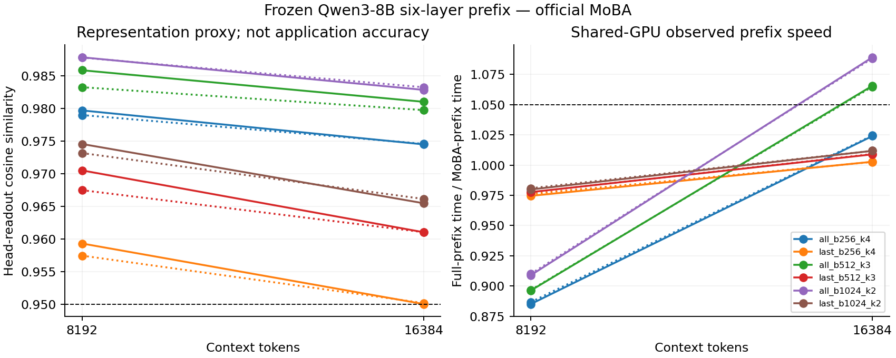

# Qwen3-8B prefix: measured MoBA feasibility

Date: 2026-09-09.

Hypothesis: `qwen3-8b-prefix6-moba-feasibility-v1`. Classification: **`shared_gpu_prefix_feasibility_supported`**.

The official MoBA implementation executes on the real frozen Qwen3-8B six-layer prefix. Several sparse settings preserve the defined readout proxies without training any weights. Runtime conclusions below apply to the shared RTX 3060 used here. Uncontended speed and the application's final accuracy remain unconfirmed.

Audited aggregate: `data/experiments/qwen_moba_prefix/20260909_registered_shared_v1/campaign_results.json`. SHA-256: `1ac332c137d7d8d596053d23ca538573b83c05d2e99beb8d23fe955e371509a6`.

## What was executed

Public `Qwen/Qwen3-8B` revision `b968826d9c46dd6066d109eabc6255188de91218`: embedding plus the first six layers, 1,780,008,448 parameters loaded. Layers 1–5 execute complete transformer blocks; layer 6 stops after attention and its output projection. All 67 loaded tensors stayed frozen, verified by before/after hashes. No MLP, attention projection, or adapter was trained.

FP16 weights and forward computation; FP32 routing logits and softmax accumulation in official MoBA, and FP32 pooled readouts. Full attention uses FlashAttention 2.6.3 with native grouped-query attention. MoBA is upstream commit `b5d58363311d3ca946f1ec444182727c15e338b5`; its required KV-head expansion, routing, rearrangement and output combining are included in timing. The auxiliary custom Triton kernel was not used for these Qwen results.

Inputs are Qwen-tokenized Wikipedia and BNC spoken text, with fixed 60/20/20 partitions. They are representative language inputs, not the user's Terra-summary distribution. Readouts pool 128-token segments of sixth-layer attention values and output-projected values. Adjacent-segment change correlation and top-quarter change F1 measure preservation of the full-attention reference; none measures hierarchy or retrieval accuracy.

## Completion and controls

- Readout-only grid: 96/120 completed; 24 baseline allocation failures at 32K under the 45% GPU-memory cap. 39 sparse cells passed all numerical readout gates. No runtime or joint selection was inferred from that stage.
- Shared-GPU prefix screen: 24/24 completed; 4 individual source/configuration cells passed the joint readout/runtime gate.
- Synthetic official-kernel diagnostic: 15/21 completed; six 32K Qwen-head-shape cases exceeded its 40% memory cap.
- Actual-prefix parity against the Hugging Face graph passed; sixth-MLP exclusion and token/head chunking have focused contract tests. Official forward/backward pilot output and gradient errors were within the stated tolerance; this feasibility campaign itself has zero optimizer updates.
- The shared RTX 3060 had an unrelated workload occupying about 5 GiB and reporting 100% utilization before these measurements. No unrelated process was stopped. Raw per-cell GPU state and all timing samples are retained.

## Whole-prefix observations

Both paths include embedding, Q/K/V and output projections, five MLPs, and identical pooled readouts. MoBA processes four query heads at a time to fit beside the other workload; full attention retains native GQA. MLP computation uses identical 2048-token chunks in both paths. Times use five alternating paired CUDA-event samples after one warmup per path. Table ranges span the two source windows, not confidence intervals.

| Tokens | MoBA layers | Block / top-k | Head cosine, minimum source mean | Change correlation, minimum | Change F1, minimum | Prefix speedup range | Both sources pass? |
| ---: | --- | ---: | ---: | ---: | ---: | ---: | :---: |
| 8192 | all | 256 / 4 | 0.9790 | 0.9906 | 0.9375 | 0.885–0.887× | No |
| 8192 | last | 256 / 4 | 0.9575 | 0.9882 | 0.9375 | 0.975–0.976× | No |
| 8192 | all | 512 / 3 | 0.9832 | 0.9887 | 0.9375 | 0.896–0.897× | No |
| 8192 | last | 512 / 3 | 0.9675 | 0.9841 | 0.9375 | 0.978–0.978× | No |
| 8192 | all | 1024 / 2 | 0.9878 | 0.9941 | 0.9375 | 0.909–0.910× | No |
| 8192 | last | 1024 / 2 | 0.9732 | 0.9849 | 0.9375 | 0.980–0.981× | No |
| 16384 | all | 256 / 4 | 0.9745 | 0.9884 | 0.9688 | 1.024–1.024× | No |
| 16384 | last | 256 / 4 | 0.9501 | 0.9864 | 0.9062 | 1.003–1.003× | No |
| 16384 | all | 512 / 3 | 0.9797 | 0.9902 | 0.9688 | 1.065–1.066× | Yes |
| 16384 | last | 512 / 3 | 0.9611 | 0.9854 | 0.9375 | 1.009–1.009× | No |
| 16384 | all | 1024 / 2 | 0.9828 | 0.9932 | 0.9375 | 1.088–1.089× | Yes |
| 16384 | last | 1024 / 2 | 0.9655 | 0.9846 | 0.9062 | 1.012–1.012× | No |

The joint gate also requires mean output-projected cosine ≥0.95, head cosine ≥0.95, change correlation ≥0.95, change F1 ≥0.90 and observed prefix speedup ≥1.05 on each source. Full endpoint values, timing samples, minima and maxima are in the cell JSON.



## Attention-only diagnostic

The following uses synthetic Q/K/V with Qwen's 32-query/8-KV-head shape and processes all heads together. It measures only attention and has no model weights or quality endpoint. It shares the GPU, so these numbers cannot be used as an uncontended benchmark or a whole-prefix speedup.

| Tokens | Block / top-k | Full attention ms | MoBA ms | Attention speedup |
| ---: | ---: | ---: | ---: | ---: |
| 2048 | 256 / 4 | 1.46 | 22.67 | 0.064× |
| 2048 | 512 / 3 | 1.46 | 21.84 | 0.067× |
| 8192 | 256 / 4 | 45.16 | 75.64 | 0.597× |
| 8192 | 512 / 3 | 45.25 | 67.67 | 0.669× |
| 8192 | 1024 / 2 | 45.16 | 58.81 | 0.768× |
| 16384 | 256 / 4 | 185.83 | 164.47 | 1.130× |
| 16384 | 512 / 3 | 185.98 | 137.42 | 1.353× |
| 16384 | 1024 / 2 | 185.62 | 117.68 | 1.577× |

At 16K, block256/top4 evaluates approximately 10.65% of the full causal token pairs per sparse layer. This counts QK/AV attention pairs only; routing, movement, projections and MLP work remain. Fewer pairs therefore do not establish proportionally lower total computation or latency.

## Held-out decision

Frozen selection: `{"length": 16384, "setting": {"block_size": 1024, "layers": "all", "top_k": 2}}`. Fresh final windows: 10/10 completed, 10/10 joint passes. Classification: `shared_gpu_prefix_feasibility_supported`.

| Source | Seed | Head cosine | Change correlation | Change F1 | Full prefix ms | MoBA prefix ms | Speedup | Joint pass |
| --- | ---: | ---: | ---: | ---: | ---: | ---: | ---: | :---: |
| wikipedia | 7 | 0.9823 | 0.9969 | 0.9375 | 2015.32 | 1858.30 | 1.084× | Yes |
| wikipedia | 17 | 0.9815 | 0.9924 | 0.9375 | 2024.61 | 1863.16 | 1.087× | Yes |
| wikipedia | 29 | 0.9815 | 0.9967 | 1.0000 | 2030.41 | 1864.80 | 1.089× | Yes |
| wikipedia | 41 | 0.9834 | 0.9978 | 0.9688 | 2031.67 | 1864.74 | 1.090× | Yes |
| wikipedia | 53 | 0.9815 | 0.9966 | 0.9688 | 2031.82 | 1865.93 | 1.089× | Yes |
| bnc_spoken | 7 | 0.9836 | 0.9882 | 0.9062 | 2032.73 | 1865.37 | 1.090× | Yes |
| bnc_spoken | 17 | 0.9785 | 0.9881 | 0.9375 | 2032.85 | 1865.83 | 1.090× | Yes |
| bnc_spoken | 29 | 0.9819 | 0.9850 | 0.9375 | 2032.58 | 1866.87 | 1.089× | Yes |
| bnc_spoken | 41 | 0.9793 | 0.9903 | 0.9375 | 2032.89 | 1864.72 | 1.090× | Yes |
| bnc_spoken | 53 | 0.9845 | 0.9893 | 0.9375 | 2033.08 | 1865.19 | 1.090× | Yes |

Head-readout relative L2 error ranges from 0.187 to 0.235; output-projected relative L2 error ranges from 0.142 to 0.174. The cosine gates measure directional similarity; the recorded L2 errors quantify the remaining numerical difference. Peak allocated CUDA memory reaches 4.528 GiB for this memory-bounded execution.

These are input-window replicates from one checkpoint, not independently trained models. Shared-GPU passage remains an exploratory deployment observation, with uncontended performance unconfirmed.

## Interpretation and limits

MoBA is technically applicable to this Qwen prefix while leaving all fully connected weights frozen. The measured readout preservation supports further application testing. It does not establish 95% final accuracy, improved retrieval, or generally better model quality. The reference is the unchanged full-attention readout, not a labeled ground truth.

The [paper](https://arxiv.org/pdf/2502.13189) and [official implementation](https://github.com/MoonshotAI/MoBA) concern sparse attention and long-context behavior. The paper's 95.31% figure is sparsity, not accuracy. Its large-context throughput results do not imply the same speedup for this shorter, consumer-GPU prefix. This experiment did not reproduce its continued-training budget, million-token regime, decoding, or the full 8B network.

Next evidence needed for an application decision: an uncontended GPU run using the existing frozen protocol, followed by actual summary inputs and labeled hierarchy/retrieval evaluation. The original TinyLLM distillation study and the stopped all-weight BLiMP search remain separate; neither supplies Qwen application evidence.

## Reproduction and provenance

Use the isolated `data/experiments/moba_paper/environment/bin/python` (PyTorch 2.4.1+cu121, FlashAttention 2.6.3) with `LD_LIBRARY_PATH=` and repository `PYTHONPATH`. The [reproduction guide](../02%20-%20Implementation/qwen-moba-feasibility-reproduction.md) includes environment and pinned-weight setup. Model, tokenizer, source corpus, token windows, producer sources and source snapshots are identified in each `producer.json`. Raw completed directories are immutable; rerun into a new output root.

```bash
env CUDA_DEVICE_ORDER=PCI_BUS_ID CUDA_VISIBLE_DEVICES=0 LD_LIBRARY_PATH= \
  PYTHONPATH=/home/rabbit/structure_net \
  data/experiments/moba_paper/environment/bin/python -m \
  experiments.structure_net.qwen_moba_shared_assessment \
  --output data/experiments/qwen_moba_prefix/NEW_shared_screen
```

| Evidence | SHA-256 |
| --- | --- |
| `data/experiments/qwen_moba_prefix/20260909_readouts_v1/campaign_results.json` | `c5b9608d0cb6f4db70f123fa059ae9848feb7c4ffba6131c895dc39ac064085e` |
| `data/experiments/qwen_moba_prefix/20260909_shared_screen_v1/campaign_results.json` | `71688956c490a6d5e74dd18c4e658e8f256a172feabdd57a0ced21cfb93e525e` |
| `data/experiments/qwen_moba_prefix/20260909_shared_final_v1/campaign_results.json` | `4b17e96bf16991e2a24cbb8754df266cf7f165b0d2261a68c74bfcb695cb3eb2` |
| `data/experiments/moba_head_benchmark/20260909_paper_shared_diagnostic_v1/campaign_results.json` | `15974b88b35ef4b4af3640ca76ff38f1ec1fa46bbc5f3cb2a7bf649b77ec0602` |

Source/tests/protocol/report are durable repository artifacts. Large checkpoint and campaign data stay under ignored `data/`. The registry retains `confirmed: false`, explicitly distinguishing completed exploratory measurements from unconfirmed uncontended performance and unmeasured application accuracy.
