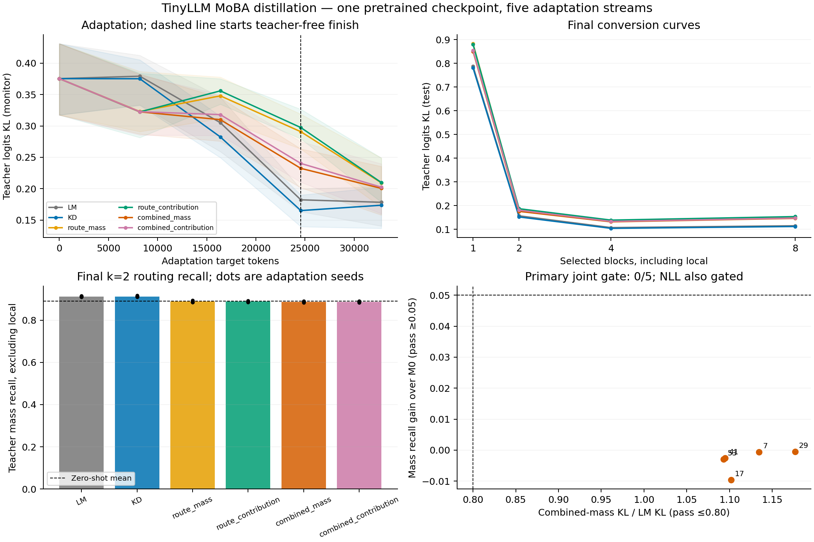

# TinyLLM MoBA teacher distillation

Status: completed. Date: 2026-09-09. Profile: PREREGISTERED.
Hypothesis: `tinyllm-moba-distillation-v1`. Classification: **`distillation_not_confirmed`**.
Primary joint gate: **0/5** adaptation seeds; confirmation: **false**.

Artifact: `data/experiments/tinyllm_moba_distillation/20260909_registered/campaign_results.json`. SHA-256: `abcb16c37bc37ffc62afe8f1060075944f86225ae9af38fc82acd8c47f86f6d6`.

[Preregistration](../07%20-%20Status%20Reports/2026-09-09_tinyllm-moba-distillation-preregistration.md)

## Measured comparison

All trained arms started from the same native-256 d8 checkpoint and used 128 updates / 32768 target tokens per arm. The table reports seed means at k=2 (local block plus one routed completed past block). F uses full attention.

| Arm | NLL | Perplexity | Teacher logits KL | Mass recall | Contribution recall | Attention MSE | Hidden MSE | BLiMP accuracy |
| --- | ---: | ---: | ---: | ---: | ---: | ---: | ---: | ---: |
| F | 4.78815 | 121.137 | 0.000000 | 1.0000 | 1.0000 | 0.000000 | 0.00000 | 75.78% |
| KD | 4.91807 | 137.748 | 0.152110 | 0.9121 | 0.8571 | 0.010347 | 0.05622 | 77.97% |
| LM | 4.92186 | 138.279 | 0.156884 | 0.9118 | 0.8568 | 0.010660 | 0.05840 | 77.81% |
| M0 | 5.12713 | 169.562 | 0.362356 | 0.8903 | 0.8446 | 0.024149 | 0.10816 | 75.78% |
| combined_contribution | 4.94720 | 141.780 | 0.180695 | 0.8868 | 0.8420 | 0.012212 | 0.06400 | 76.25% |
| combined_mass | 4.94099 | 140.963 | 0.175624 | 0.8871 | 0.8410 | 0.011941 | 0.06222 | 76.88% |
| route_contribution | 4.95223 | 142.570 | 0.186918 | 0.8883 | 0.8436 | 0.012712 | 0.06680 | 76.88% |
| route_mass | 4.95086 | 142.403 | 0.184913 | 0.8887 | 0.8422 | 0.012525 | 0.06553 | 77.19% |




Combined mass distillation increased mean teacher-logit KL by 11.94% relative to LM-only, changed routing recall by -0.32 percentage points relative to zero-shot conversion, and changed NLL by 3.19% relative to F. These are descriptive ratios of means; the decision uses the paired seed gates below.

| Seed | KL ratio vs LM (≤0.80) | Recall gain vs M0 (≥0.05) | NLL ratio vs F (≤1.05) | KL | Recall | NLL | Joint |
| --- | ---: | ---: | ---: | --- | --- | --- | --- |
| 7 | 1.1346 | -0.0006 | 1.0349 | fail | fail | pass | fail |
| 17 | 1.1019 | -0.0096 | 1.0271 | fail | fail | pass | fail |
| 29 | 1.1768 | -0.0004 | 1.0343 | fail | fail | pass | fail |
| 41 | 1.0949 | -0.0025 | 1.0352 | fail | fail | pass | fail |
| 53 | 1.0933 | -0.0029 | 1.0284 | fail | fail | pass | fail |

## Adaptation trajectory and sparsity

Monitoring windows are disjoint from final evaluation; no checkpoint was selected from these values. The last 32 updates use LM-only with the teacher removed.

| Arm | KL at update 0 | 32 | 64 | 96 | 128 | Final parameter deformation |
| --- | ---: | ---: | ---: | ---: | ---: | ---: |
| LM | 0.37540 | 0.37928 | 0.30520 | 0.18223 | 0.17828 | 0.00279 |
| KD | 0.37540 | 0.37521 | 0.28246 | 0.16510 | 0.17363 | 0.00275 |
| route_mass | 0.37540 | 0.32298 | 0.34795 | 0.29079 | 0.20939 | 0.00320 |
| route_contribution | 0.37540 | 0.32235 | 0.35589 | 0.29740 | 0.20980 | 0.00321 |
| combined_mass | 0.37540 | 0.32249 | 0.31001 | 0.23236 | 0.20048 | 0.00312 |
| combined_contribution | 0.37540 | 0.32271 | 0.31802 | 0.24024 | 0.20241 | 0.00312 |

| Arm | Teacher KL, k=1 | k=2 | k=4 | k=8 |
| --- | ---: | ---: | ---: | ---: |
| M0 | 0.97540 | 0.36236 | 0.03623 | 0.00000 |
| LM | 0.78790 | 0.15688 | 0.10721 | 0.11494 |
| KD | 0.78080 | 0.15211 | 0.10407 | 0.11182 |
| route_mass | 0.88314 | 0.18491 | 0.13684 | 0.15127 |
| route_contribution | 0.88039 | 0.18692 | 0.13880 | 0.15362 |
| combined_mass | 0.85035 | 0.17562 | 0.13151 | 0.14617 |
| combined_contribution | 0.85417 | 0.18069 | 0.13339 | 0.14762 |

## Downstream control and mechanistic boundaries

BLiMP accuracy uses 128 fixed minimal pairs across four agreement suites and summed sentence log probability. These examples are shared across adaptation seeds; five evaluations are not five independent BLiMP datasets.

| Arm | Subject–verb 1 | Subject–verb 2 | Anaphor number | Determiner–noun | Sparse-active examples |
| --- | ---: | ---: | ---: | ---: | ---: |
| F | 65.62% | 75.00% | 75.00% | 87.50% | 0.00% |
| M0 | 65.62% | 75.00% | 75.00% | 87.50% | 0.00% |
| LM | 72.50% | 71.88% | 77.50% | 89.38% | 0.00% |
| KD | 71.88% | 74.38% | 76.25% | 89.38% | 0.00% |
| route_mass | 72.50% | 71.25% | 75.62% | 89.38% | 0.00% |
| route_contribution | 73.75% | 70.62% | 73.75% | 89.38% | 0.00% |
| combined_mass | 71.25% | 71.88% | 74.38% | 90.00% | 0.00% |
| combined_contribution | 72.50% | 70.62% | 72.50% | 89.38% | 0.00% |

At k=2 the combined-mass arm used 34.63% of causal attention edges and captured 81.83% of teacher attention mass (averaged over layers, heads, and queries). These are mask statistics; the reference implementation still computes dense tensors.

| Arm | Mass routing KL | Contribution routing KL | Next-token accuracy | Teacher mass captured | Causal edges selected |
| --- | ---: | ---: | ---: | ---: | ---: |
| F | 1.57694 | 1.67934 | 25.61% | 100.00% | 100.00% |
| KD | 1.58157 | 1.68697 | 24.53% | 82.11% | 34.63% |
| LM | 1.57503 | 1.67882 | 24.49% | 82.10% | 34.63% |
| M0 | 2.19994 | 2.31074 | 22.23% | 81.69% | 34.63% |
| combined_contribution | 0.92149 | 0.98626 | 24.00% | 81.82% | 34.63% |
| combined_mass | 0.91828 | 0.98882 | 24.10% | 81.83% | 34.63% |
| route_contribution | 0.92331 | 0.98836 | 24.10% | 81.85% | 34.63% |
| route_mass | 0.92327 | 0.99420 | 24.07% | 81.86% | 34.63% |

## Campaign integrity and validity

Requested 40 cells; completed 40; failed 0; retried 0; excluded 0; reused 0; unexecuted by gate 0.
Full-budget parity passed 5/5; maximum logit error 4.6730042e-05, tolerance 1e-4. The teacher state hash remained unchanged. Saved checkpoints reloaded with exactly matching tensors and logits.

Producer fingerprint: `ca7ff90dc823dbfcad703320dbd9b15d2dde6990df46bda445ae610db1f57b2e`. Producing Git base: `747c1a6daa752634a91a55eb5f9e78c5421d1fbe`. Uncommitted dependencies were hashed and copied under `producer_source/`; existing user work was preserved.
Environment: {'cpu_threads': 2, 'cuda': '12.1', 'deterministic_algorithms': True, 'device': 'cuda:0', 'device_name': 'NVIDIA GeForce RTX 2060 SUPER', 'numpy': '2.3.1', 'python': '3.11.13', 'tf32': False, 'torch': '2.5.1+cu121', 'visible_devices': '2'}. One sequential worker, physical GPU 2. Shared-device times are operational diagnostics, not benchmarks.

Validation: 13 CPU numerical/experiment contract tests and four registry contract tests; eight-arm tiny CPU lifecycle and completed-result reuse; eight-arm representative CUDA lifecycle at the intended one-worker concurrency (peak allocated memory 1.64 GB). The initial CPU shakedown exposed a PyTorch argsort keyword incompatibility; its root was retained, the implementation was corrected before primary execution, and the full test/lifecycle ladder passed. No primary evidence was reused from that failed systems attempt.

All direct result, checkpoint, schedule and preserved-source hashes were checked during finalization. The finalizer recomputed primary seed gates, classification and aggregate means from direct records.

## Interpretation

The full preregistered hypothesis is not confirmed. Secondary improvements and contribution-target comparisons remain informative but cannot change the failed primary gate.

The zero-shot router already recalled 89.03% of teacher-important past blocks under the declared recall estimator. Combined mass distillation reduced soft-routing KL by 58.26% relative to zero-shot, while hard-block recall changed by -0.32 percentage points. The distinction between matching the soft routing distribution and improving discrete block selection is a direct measured finding; it does not establish the cause of the fidelity tradeoff.

No BLiMP example activated sparsity at the tested budget: each sentence fit within the available two-block coverage. Thus BLiMP differences measure consequences of weight adaptation on short sentences, and provide no evidence for long-range sparse routing quality.

The combined objectives and common unfreezing/curriculum schedule test a conversion package. Route-only versus LM isolates adding a routing loss within that schedule. Projected value norms are contribution proxies, not causal ablation measurements. Top-k uses teacher-important completed past blocks and excludes the forced local block from recall.

This experiment covers one pretrained model, native length 256 and one small token budget. It does not establish orders-of-magnitude data savings, long-context quality, or accelerated inference. Short BLiMP examples primarily test weight adaptation rather than long-range routing. The parent validation suffix was reused with disjoint adaptation, monitoring and final-evaluation partitions; it is not historically unseen model-selection data.

## Reproduction and evidence

```bash
CUDA_DEVICE_ORDER=PCI_BUS_ID CUDA_VISIBLE_DEVICES=2 pixi run python -m \
  experiments.structure_net.tinyllm_moba_distillation --device cuda:0 \
  --output data/experiments/tinyllm_moba_distillation/20260909_registered
```

This command hash-verifies and reuses completed evidence. A changed producer or protocol requires a new dated root. The parent checkpoint and token-stream SHA-256 values are fixed in the preregistration. Per-arm result files include k-curves, stage losses, BLiMP item scores, complete configuration, and checkpoint/schedule hashes.

Sources: [MoBA](https://github.com/MoonshotAI/MoBA), [MoBA paper](https://arxiv.org/abs/2502.13189), [BLiMP](https://github.com/alexwarstadt/blimp).
