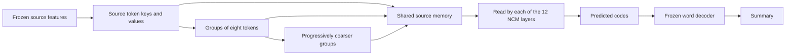

# Source hierarchy read by every NCM layer

The requested architecture is implemented and its full tree training run is
active on physical GPU1, an RTX2060 with 6GB. The source tree is shared by all
twelve NCM generator blocks; each block has its own attention queries and
learned mixture over hierarchy levels.

These are contiguous groups of source positions. They are not sentence-boundary
annotations or additional LLM-generated summaries. Original token attention
remains available. Each example masks hierarchy levels introduced only by
another example's batch padding.

The comparison has two fixed arms:

| Property | Tree | Flat source attention |
| --- | --- | --- |
| Source-attending generator blocks | 12 | 12 |
| Ancestor levels | Eight-way pooled hierarchy | None |
| Trainable parameters | 123,063,936 | 115,939,968 |
| Admitted training pairs | 1,376 | 1,376 |
| Optimizer updates | 2,048 | 2,048 |
| Training presentations | 65,536 | 65,536 |
| Initial checkpoint | Public epoch2 | Public epoch2 |
| Training GPU | RTX2060 | Same RTX2060 |

Both use the same order, corruption schedule, optimizer settings and frozen
codec. Full training starts from the original checkpoint, not pilot weights.
Tree runs first, followed by the flat arm after the tree training audit. The
extra tree parameters remain a capacity difference in this comparison.

The corrected tree passed real gradient, mixed-precision update and exact
restart checks at 3.91GB peak own GPU allocation. Flat attention passed the
same lifecycle at 3.87GB. Both measurements use cached frozen source features
and exclude a resident Llama encoder. Three further CPU tests passed for the
evaluation consumer: complete training admission, strict restoration of both
architectures with nonzero added branches, and rejection of the wrong arm.

The evaluation entry point is
`experiments.structure_net.ncm_source_hierarchy_development`. It preserves
the existing semantic first judgments and grades the same source-disjoint128
DEV cases, tree before flat. Terra evaluates complete-summary quality; Sol
confirmation follows the existing qualification gate. Exact wording matches
are not the summary accuracy metric. The separate broad codec adaptation is
not installed in either architecture arm.

No trained hierarchy accuracy or inference speed result is available yet.
The latest completed application DEV result is still 0/128; the public epoch4
grade is in progress. Final320 remains sealed. Retaining token attention and
adding ancestor reads increases attention work, so a speedup cannot be inferred
from this architecture or its memory fit.

Evidence: `20261027_source_hierarchy_tree_train_v1`,
`20261027_source_hierarchy_dense_pilot_v1`, and
`20261027_source_hierarchy_DEV_CPU_v1.json` under
`data/experiments/ncm_paper_regime`. See the fixed comparison and evaluation
plans in `docs/07 - Status Reports` for the admission and scoring rules.
