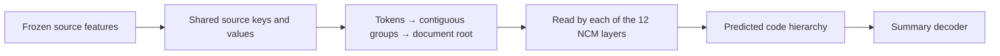

# Source hierarchy on the trained NCM checkpoint

The real-checkpoint pilot passed on two existing TRAIN controls, including the
longest diagnostic source. Every one of the twelve NCM generator blocks now has
access to the same source hierarchy. The first installation preserves the
checkpoint's exact deterministic outputs and has usable gradients at every new
branch. This establishes a working initialization, not improved task accuracy.

The tree pools groups of eight with padding excluded and weights proportional
to valid leaf counts. Each layer learns which hierarchy levels to read. Original
token-level attention remains available for exact details. With 2,048 source
positions the tree adds 293 ancestor positions. The added output projections
start at zero; original weights and parameter objects are retained.

| Real-checkpoint check | Result |
|---|---|
| Archived epoch2 codes and raw word IDs reproduced | Passed |
| Every initial teacher logit, generated code and raw word ID unchanged | Exact |
| Original tensors, parameter objects and installation RNG preserved | Passed |
| Finite, nonzero gradients on all 12 tree-output projections | Passed |
| Finite, nonzero gradients on all 9 new token-attention outputs | Passed |
| Initial router and new query gradients | Zero, as required by zero output initialization |
| Frozen codec and word-source path | Unchanged, no gradients |
| Peak own CUDA allocation, FP32 on RTX 2060 SUPER | 2,243,461,632 bytes (2.24 GB) |
| Optimizer updates / new judge requests | 0 / 0 |

The generator/concept-source trainable population is 123,063,936 parameters,
compared with 115,939,968 for twelve-layer dense source attention and 105,323,136
for the original three source-attention blocks. These counts exclude the frozen
portion of the complete model. This dense prototype adds computation. No speed
improvement, sparse routing, mixed-precision training or summary-quality gain has
been measured.

The actual locked-Pixi process completed with exit zero: tool session `73402`,
terminal chunk `ce1102`. Artifacts are in
`data/experiments/ncm_paper_regime/20261027_source_tree_checkpoint_pilot_v1`.
The result SHA-256 is
`71e1445595b97ce7395e13f1091fb5450bc747a3496381488c2db8cae11bfcda`.
The artifact-bound actual receipt SHA-256 is
`c1e1b1a662eb697bd17f60c9b93cf46ceade390d400395884b41f7bd4f70494b`.
Both ongoing training workers retained their process and invocation identities.

The next quality comparison must separate source coverage from hierarchy:
original three-source-block model, twelve-layer dense source attention, and
twelve-layer source hierarchy, using identical data and exposure. The new
hierarchy still needs representative optimizer, precision and restart checks
before that training experiment. Current completed application semantic DEV
remains 0/128; no new model-quality result is supplied by this pilot and the
320-case final cohort remains sealed.
