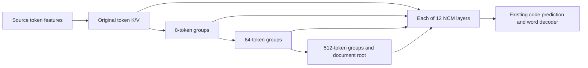

# NCM source-tree mechanism check

Exploratory hypothesis `ncm-source-tree-mechanism-v1` remains unregistered and
untested for trained quality. Its synthetic CPU contract check passed all four
tests under locked Pixi. No real checkpoint, optimizer run or GPU timing was
tested. The prototype is in `experiments/structure_net/ncm_source_tree.py`.

The source tree is shared, while each layer independently queries it and learns
how to combine ancestor levels. Dense token access remains available for detail.
Every added hierarchy branch starts with a zero output projection. Synthetic
evaluation logits are initially identical to the original network, original
parameters and RNG state are preserved, and strict reload reproduces outputs.
Tests also verify weighted roots under padding, finite gradients to all twelve
branches, later gradients to hierarchy-level selection, and detached source
features. These are mechanism checks, not semantic understanding measurements.

The dense prototype adds pooled positions and computation. At 2,048 tokens,
there are 293 extra ancestor positions. It neither prunes source tokens nor
claims increased tokens/sec. Testing whether hierarchy improves summary quality
requires the matched controls in the
[prospective mechanism note](../07%20-%20Status%20Reports/2026-10-27_ncm-source-tree-mechanism.md).

Evidence: `data/experiments/ncm_paper_regime/20261027_source_tree_CPU_qualification_v2/result.json`,
SHA-256 `cb985fb69897f37fd0ae9972889e8332d63e3ce95c92ea08e84fe0e4ca96a5ab`.
Actual focused test session 66217 ended with exit zero, four passes in 3.51 seconds.
The earlier v1 invocation failed during repository-wide fixture collection due
to missing SciPy and ran no mechanism tests; its failure receipt is preserved.
The focused rerun uses `--noconftest` because it needs no repository-wide fixtures.
