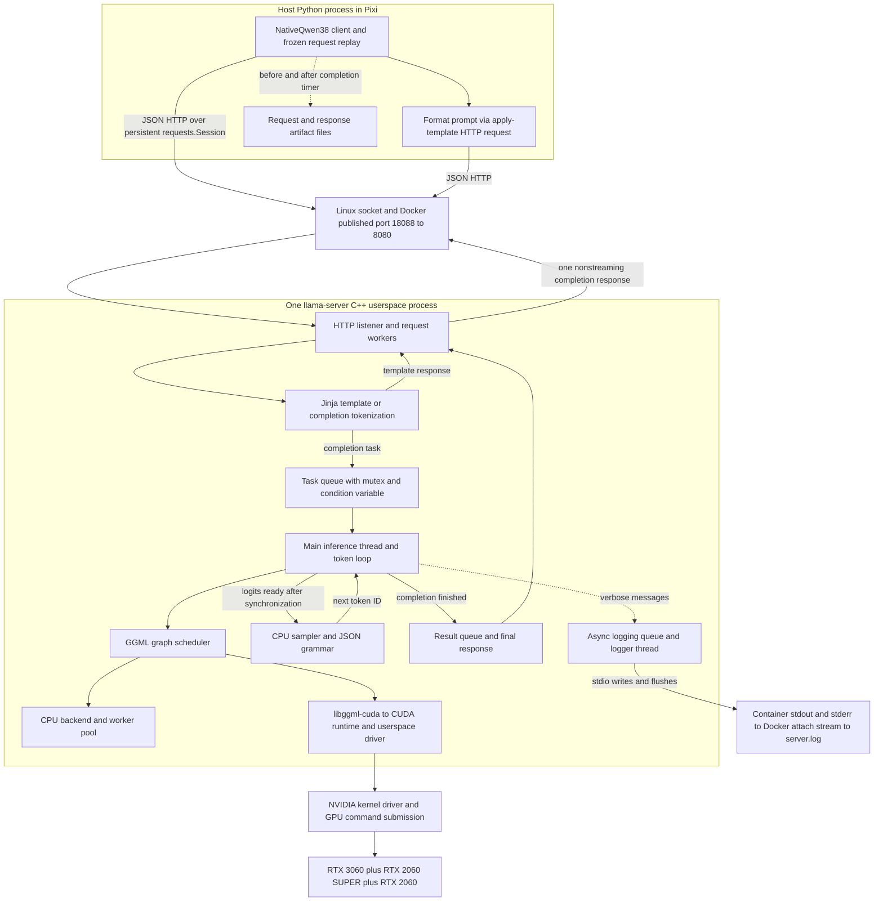
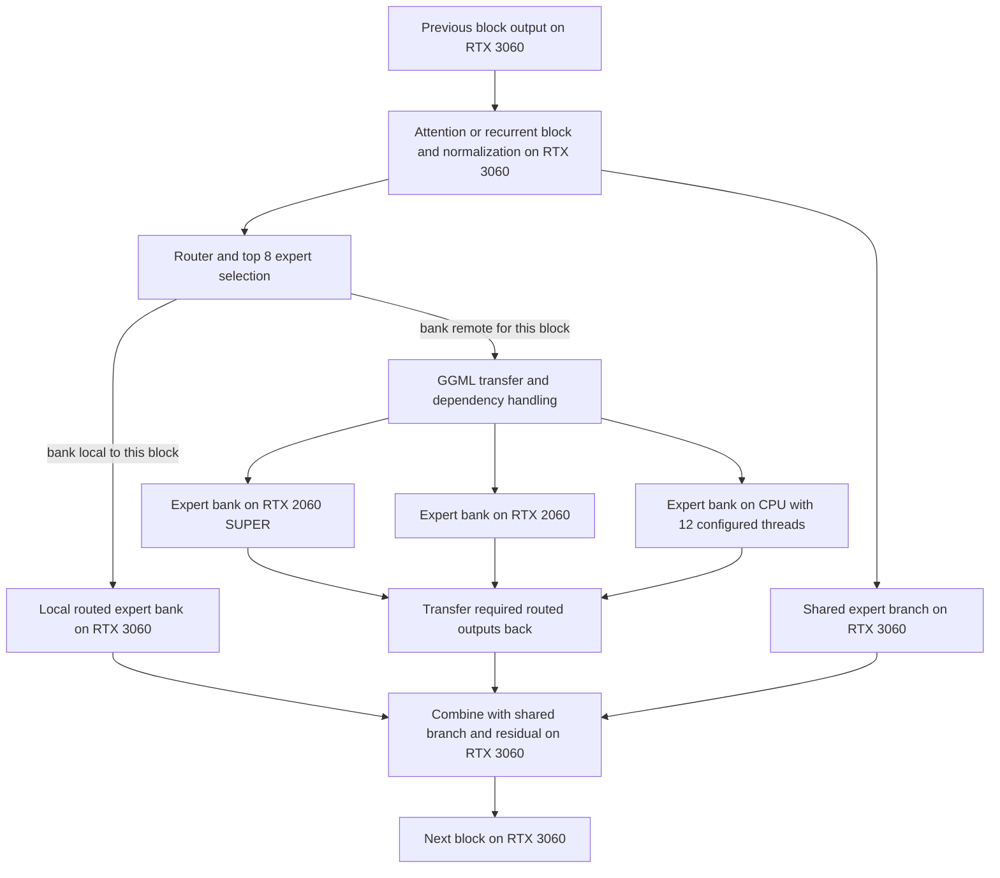

# WORD_GAMES communication and synchronization map

The latest measured three-GPU configuration runs one native llama.cpp server.
Python communicates with it once per completion, plus a separate template
request. Transformer layers execute inside that C++ process. The main places
to investigate are native backend scheduling and transfers, two CPU expert
banks, and the return to CPU sampling after every generated token.

The existing log accounts for 4,778 decode intervals: **13.24 ms per token
inside decode and synchronization, 0.77 ms after decode for sampling and
bookkeeping, and 0.030 ms before the next decode**. The first interval includes
both useful computation and coordination; it is not a measurement of IPC alone.

This maps the completed `packed38` benchmark configuration, whose reported
throughput was 50.21 visible output tokens/s including prefill. Its temporary
server has stopped and the regular Qwen3-8B service is restored. The earlier
Qwen14B/Qwen3B two-worker Unix-socket prototype is a separate implementation;
it is not in this model's layer execution path.

## Process and software boundaries



The Python client performs `/apply-template` before `/completion`. The latter
uses `stream: false`; there is no HTTP or Python round trip per generated token
or transformer layer. Docker is a process/container and networking boundary,
not a GPU worker RPC service. C++ queues, CPU worker synchronization, and CUDA
API calls remain inside the native process. The kernel driver is involved in
device management and submission; this audit does not assign a syscall to each
CUDA operation or assume that each API call crosses into the kernel.

The inference thread temporarily lets a helper thread handle queued control
tasks while decode runs. At the end it joins that helper's current work. The
log also shows a `NEXT_RESPONSE` task posted each iteration, frequently declined
while decode is active and subsequently processed again. Condition-variable
waits are notified when work arrives; a one-second timeout in the source does
not mean every request waits one second.

The Python monitor invokes `nvidia-smi` once per second and occasionally checks
Triton readiness. Triton and OCR are neighboring services, not intermediaries
between this model's layers. Model loading and CUDA compilation cache activity
belong to startup; the measured path uses resident expert weights.

## Movement within a transformer block



Only the branch corresponding to a block's bank placement executes. This
diagram shows mathematical dependencies and ownership of expert projections;
it does not assert that the independent shared and routed branches currently
overlap, or that every intermediate tensor has the same placement as its
projection weights.

| Runtime device | Physical card | Routed expert banks |
| --- | --- | --- |
| CUDA0 | RTX 3060 12 GB | 18–22 and 26–39, 19 banks |
| CUDA1 | RTX 2060 SUPER 8 GB, physical GPU 2 | 0–7 and 23, 9 banks |
| CUDA2 | RTX 2060 6 GB, physical GPU 1 | 8–17, 10 banks |
| CPU | Xeon E5-2697 v2 | 24–25, 2 banks |

Attention, recurrent state and shared experts remain on the 3060. Nineteen
blocks therefore need work on another GPU and two need CPU expert computation.
Each remote block must supply its inputs and return the required results before
the dependent next block proceeds. Adjacent banks on the same secondary GPU do
not eliminate these round trips because the intervening attention remains on
the 3060. The exact number of copies can exceed this semantic boundary count.

The CUDA backend calls `cudaMemcpyPeerAsync` on the **source compute stream**,
records an event there, and inserts `cudaStreamWaitEvent` on the destination
stream. It already uses native asynchronous CUDA coordination. All GPU pairs
report no peer-memory access. Host staging is therefore the expected physical
transfer route, but the driver's exact staging implementation and buffer
lifetime require a CUDA trace; they are not exposed by the GGML call alone.

Pinned host memory supplies storage for CPU/device exchanges. It does not
replace signaling. `CUDA_Host` in the placement logs means host memory, not
GPU VRAM. Resident expert weights are not serialized through Python or copied
across the process boundary at each layer.

The GGML scheduler protects input-buffer reuse with events, synchronizes for
unsupported asynchronous copy paths, and can wait on a previous backend when a
new split has no explicit input but may reuse storage. These dependencies must
survive any scheduling change. The reserve log reports **44 decode splits and
46 prefill splits**. These are backend graph partitions, not Python calls or
measured CUDA graph launches.

## Where the recorded time goes

The retrospective audit verifies all 36 stored response hashes and the six
native libraries relevant to this path against the recorded producer. It
excludes the six-token warmup and the first output of each request when
extracting decode cycles from log timestamps.

| Region in 4,778 decode cycles | Mean per token | Total | Share of decode cycles |
| --- | ---: | ---: | ---: |
| Previous token processing to next decode marker | 0.0304 ms | 0.1451 s | 0.22% |
| Decode marker through completed decode/synchronization and queue yield | 13.2406 ms | 63.2634 s | 94.31% |
| End of queue yield to token processing marker | 0.7691 ms | 3.6747 s | 5.48% |
| Entire cycle | 14.0400 ms | 67.0832 s | 100% |

The reconstructed cycles differ from the server's summed decode timing by
only **94 microseconds**. This checks the interval accounting, not the accuracy
of individual log timestamps. Logging perturbs execution. The post-decode
interval contains CPU sampling, repeated synchronization calls, grammar
acceptance, token decoding and bookkeeping; it is not isolated grammar time.
The decode region includes GPU kernels, CPU expert work, transfers, scheduling,
waits, and the queue-worker join. Its dominant subcomponent remains unresolved.

Across completions, the Python request timer totals **95.1678 s**, against
**27.8874 s prefill + 67.0833 s decode** reported by the server. The residual is
**0.1972 s, or 0.207%**. That makes request transport a lower-priority suspect
within this timer. The residual is not an isolated network benchmark and cannot
separate HTTP, scheduling and other server overhead.

The completion timer starts after template formatting and the request-file
write. It stops before response JSON parsing and the response-file write.
Consequently, the published 50.21 tok/s does not time the entire controller
workflow. An application-level timer should include those steps before a
claim about full bridge latency. The old two-worker Unix-socket health timings
do not measure this TCP completion path.

## Concrete work to remove or measure

| Priority | Finding | Evidence and next comparison |
| --- | --- | --- |
| First simple A/B | Verbose logging on the token path | `--verbosity 5` generated 88,245 lines and 6,022,890 bytes including startup/warmup. Logging formats messages under a mutex, can block on a full queue, and flushes each entry in its worker. Compare a quiet run with identical requests, tokens and model configuration. Its independent cost is unmeasured. |
| First native-code target | Repeated synchronization after decode | Source shows at least seven context-wide synchronization calls per ordinary output: one after decode, one at sampler entry, three sampled-data getters, the raw-logits getter and the sampled-token getter. Each walks all backends. More occur on grammar rejection. Profile actual API counts, then use an internal already-synchronized read path while retaining public API semantics. |
| Main profiling target | The 13.24 ms decode region | Capture CPU and CUDA timelines around native decode. Attribute CPU expert execution, copies, wait calls, graph launch/rebuild and kernel execution separately. Do not equate this region with communication overhead. |
| Potentially larger scheduling gain | Shared and routed experts depend on the same normalized input | Their mathematical independence permits overlap. Check actual CUDA scheduling, then schedule the 3060 shared branch while remote expert work proceeds, preserving the final join and buffer lifetimes. Reordering C++ graph-builder calls alone is insufficient. |
| Measurable host return | Raw logits and CPU sampling every token | Backend sampling is false and JSON grammar is active. A 248,320-entry FP32 logit vector is 993,280 bytes per output, followed by CPU candidate construction. This transfer lies inside decode; subsequent sampling/bookkeeping averages 0.769 ms. This runtime disables backend sampling when grammar is active, so merely passing its flag will not fix this path. Preserve grammar semantics in any replacement. |
| Additional native bookkeeping | Internal task churn | The log contains 4,880 `NEXT_RESPONSE` posts and 4,880 declined-task messages. The queue helper can process and defer the same next-response task during decode. Remove pointless churn only while preserving cancellation/control responsiveness. Its independent cost is unmeasured; the entire interval before decode averages only 30 microseconds. |
| Transfer refinement | Copies share the source compute stream | Test persistent explicit staging and dedicated transfer streams. The separate 8 KiB probe found about 4–6% lower handoff latency than the current API pattern; this is not a model-speed estimate. Profile actual tensor sizes and dependency chains before applying it. |
| Conditional issue | MoE fallback can copy routing IDs to CPU and synchronize twice | This branch exists, but optimized quantized paths can bypass it. Confirm whether the actual decode or prefill kernels enter it before treating it as a bottleneck. |

The two CPU expert banks are also a compute and synchronization cost. Moving a
bank can help even if the transport is already efficient, but that is a separate
placement experiment with a VRAM constraint. Likewise, the graph reallocation
messages observed around requests do not demonstrate per-token graph rebuilds.
The runtime already contains CUDA graph support and native events; a profile
must establish reuse before proposing to enable features that are present.

## Evidence and reproduction

- [Machine-readable audit](../../data/experiments/word_games/20261031_ipc_path_audit_v1/audit.json)
  SHA256 `0b3abe64166dc65d7aee57526540db80b997198efffb7ea3a42f8b7d16b40e9a`.
- [Per-token intervals](../../data/experiments/word_games/20261031_ipc_path_audit_v1/token_intervals.jsonl).
- [Audit source](../../experiments/word_games/audit_ipc_path.py) and
  [timestamp/accounting tests](../../tests/word_games/test_ipc_path_audit.py).
- [Original placement and throughput report](2026-10-31_word-games-expert-split-and-three-gpu.md).
- [Separate native signaling microbenchmark](../../data/experiments/word_games/20261031_cuda_native_signaling_v2/result.json).

The source audit uses the local b11960 tree under
`.pixi/word-games-hybrid/source`. It contains inactive experimental hybrid
hooks; the verified packed-run binaries are the original native distribution.
Relevant source files and their hashes are listed in `audit.json`.

| Boundary | Source anchors |
| --- | --- |
| Python timing and HTTP | `experiments/word_games/native_speed.py:61`, `qwen38_moe_runtime.py:58` |
| Container and GPU mapping | `three_gpu_experts.py:27`, `experiments/neural_architecture_lab/run_word_games_packed_experts.py:25` |
| Native request handling | `tools/server/server-context.cpp:5299`, `tools/server/server-http.cpp:153` |
| Native queue worker and join | `tools/server/server-queue.cpp:222` |
| Decode then sampling | `tools/server/server-context.cpp:4692`, `server-context.cpp:4876` |
| CPU sampling and repeated getters | `common/sampling.cpp:134`, `common/sampling.cpp:606`, `src/llama-context.cpp:4328` |
| Raw logit download | `src/llama-context.cpp:2078` |
| Transformer shared/routed branches | `src/models/qwen35moe.cpp:488` |
| Scheduler copies and waits | `ggml/src/ggml-backend.cpp:1823`, `ggml-backend.cpp:2133` |
| CUDA copy and native events | `ggml/src/ggml-cuda/ggml-cuda.cu:2686` |
| Conditional CPU routing fallback | `ggml/src/ggml-cuda/ggml-cuda.cu:2145` |
| Logging queue and flush | `common/log.cpp:155`, `common/log.cpp:238`, `common/log.cpp:344` |

Reproduce without starting a model or changing services:

```sh
pixi run pytest -q tests/word_games/test_ipc_path_audit.py
pixi run python -m experiments.word_games.audit_ipc_path \
  --output data/experiments/word_games/NEW_IPC_PATH_AUDIT
```

This is a retrospective source-and-log map. It supplies measured coarse
intervals and specific profiling targets, not a kernel trace, a new speedup,
or a model-quality result.
