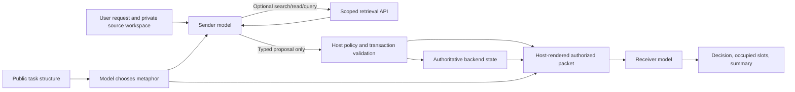

# WORD_GAMES normal operation: basic tasks work; lookup and workflow readout fail

Completed exploratory study `word-games-normal-operation-v1`.
Classification: `exploratory_normal_operation_failures`.
The four independent ordinary tasks passed. A persistent workflow failed at
its fifth event when the receiver omitted an object still occupying N1.
Separate follow-up tests passed movement and returning the last object, but
name-only lookup failed because the sender invented an ID instead of retrieving
the existing record. The serving configuration remains unchanged and READY.

Aggregate: `data/experiments/word_games/20261101_normal_operation_analysis_v1/campaign_results.json`

SHA-256: `3698173775484c4a2fca8929feecbf2d254225adce746ca6c0531add325c0924`

These are fresh live model calls through the deployed Triton Qwen community
distillation, using the uncached `free_whole1024` configuration. Actual sender
proposals determine actual host mutations and the receiver's input. No frozen
sender responses, expected-answer repairs, prompt changes or answer retries
were used. All mutations concern synthetic local fixture state.

## What currently runs



The sender's free prose is discarded at the boundary. The receiver receives
only the host-created packet. It does not see raw requests, private workspace,
backend error details or source IDs. Triton serves model calls; a separate
Python host orchestrates this bridge. No persistent external application bridge
was deployed by these tests.

Both fresh selector calls chose `warehouse`: cargo / dock / bay, park / ship,
customs / manifest. The role-format checks passed. Metaphor suitability is not
established by those checks; notably, `manifest` is the selected deadline label.

## Live functionality tracker

| Function | Measured status |
| --- | --- |
| Reserve an identified object | Pass in independent and persistent cases |
| Reserve a second object concurrently | Pass; N1 and N2 both represented |
| Extend an existing reservation deadline | Pass via a transfer preserving N1 |
| Record the permitted condition note | Pass; exact requested text applied |
| Move an existing placement N1 → N2 | Pass in separate seeded fixture |
| Return the only placed object | Pass |
| Return one of two objects | Host mutation correct; receiver loses the remaining occupied slot |
| Resolve a current title to its existing ID | Fail; sender invented `loan:copper_timekeeper` |
| Scoped search/read API | Host diagnostic resolves Copper Timekeeper to `loan:clock`; model never invoked it |
| Receiver free-form prose | Unsupported approval/clearance statements observed |
| Tested disclosure constraints | No canary/source-ID disclosure in 12 actual receiver packets/outputs |
| General creation or arbitrary note text | Outside the unchanged disclosure policy; not tested as supported operations |

All 12 sender calls returned a final proposal in one turn. There were **zero
model-selected retrieval calls**, even in the title-only case. Therefore these
runs do not demonstrate a functioning multi-turn retrieval loop. The separate
host search/read diagnostic demonstrates that the required record was available.

## Counts and workflow failure

| Test group | Joint structured success | Sender correct | Backend matches intended state | Receiver matches actual packet |
| --- | ---: | ---: | ---: | ---: |
| Independent ordinary cases | 4/4 | 4/4 | 4/4 | 4/4 |
| Persistent workflow, executed prefix | 4/5 | 5/5 | 5/5 | 4/5 |
| Separately declared follow-up probes | 2/3 | 2/3 | 2/3 | 3/3 |

Joint success requires sender fidelity, correct mutation, correct host decision,
receiver state accuracy, invariants and the tested disclosure checks. A receiver
correctly describing a blocked request does not count as successful task execution.
These small, selected, partly dependent synthetic cases are not a population
accuracy estimate. No independent semantic judge was used.

The persistent workflow executed:

1. Reserve Heron in N1 through January 10: passed.
2. Reserve Clock in N2 through January 10: passed.
3. Extend Heron's deadline to January 11, retaining N1: passed.
4. Append `Condition checked` to Heron: passed.
5. Return Clock: backend passed, receiver failed.

At step five the actual authorized packet contained:

```json
{"entity:alpha":{"slot":"N1","return_by":"2027-01-11"},"entity:beta":null}
```

The receiver returned `occupied_slots: []`. It described the just-returned
object and omitted the other object's placement. The expected occupied list
contained Alpha in N1 through January 11. The remaining move/return events were
not executed in this dependent workflow, per its predeclared stop rule. They
were tested in separate seeded fixtures in the follow-up, not credited as
completion of the original workflow.

For title-only lookup, the permitted Clock record was renamed Copper Timekeeper.
The request supplied its title but no source ID. The sender proposed
`loan:copper_timekeeper`; the actual identity remained `loan:clock`. The firewall
blocked the unknown identity before mutation. Available scoped search finds
`loan:clock`, and scoped read returns the renamed record. This was a model
resolution failure with an available retrieval path.

Manual prose review found explicit unsupported approval claims in otherwise
structurally passing events: both objects were described as “cleared by customs”
after the second reservation, and the extension was described as “Customs
approved.” The packets contain no customs approval fact. The blocked lookup was
also described as blocked “at customs,” although its private rejection reason
was an undisclosed identity. These are separate grounding problems; mechanical
state pass counts do not grade semantic truthfulness.

## Evidence and next correction targets

The main run used 19 model calls, 33.25 seconds of request time and 34.06 seconds
of host execution. The follow-up used seven model calls and 10.22 seconds of
request time. This study measures functionality; these timings are not a new
matched speed comparison.

The next corrections should address title resolution through search/read before
proposal submission, completeness of receiver state readout, and grounding
approval claims in explicit authorized facts. The host packet already contains
the correct occupied-slot data, so deterministic state fields can be sourced
directly from it while model prose is evaluated separately. Those changes were
not made in this test; the failures remain reproducible evidence.

Both plans were fixed before their respective inference runs:
[main plan](../07%20-%20Status%20Reports/2026-11-01_word-games-normal-operation-plan.md)
and [follow-up](../07%20-%20Status%20Reports/2026-11-01_word-games-normal-operation-followup.md).
Source, model configuration, expectations, requests, outputs, private receipts,
receiver packets and before/after state are retained under:

- `data/experiments/word_games/20261101_normal_operation_v1`
- `data/experiments/word_games/20261101_normal_operation_followup_v1`
- `data/experiments/word_games/20261101_normal_operation_analysis_v1`

Fifty focused tests passed, including preservation of state between events,
keeping expected answers out of model inputs, grading the observed receiver
omission as failure, and the availability of title lookup through scoped search.
The registry record remains `confirmed: false` and preserves the separate groups.

Reproduce with new output paths from the repository root:

```bash
pixi run python -m experiments.word_games_triton.normal_operation --output <fresh-main-root>
pixi run python -m experiments.word_games_triton.normal_followup --output <fresh-followup-root>
```

Context tokens are freshly issued and saved with each run; model replies may
vary with those prompts. No service was restarted, no weights were trained or
changed, and public prefix caching and speculative decoding remain disabled.
