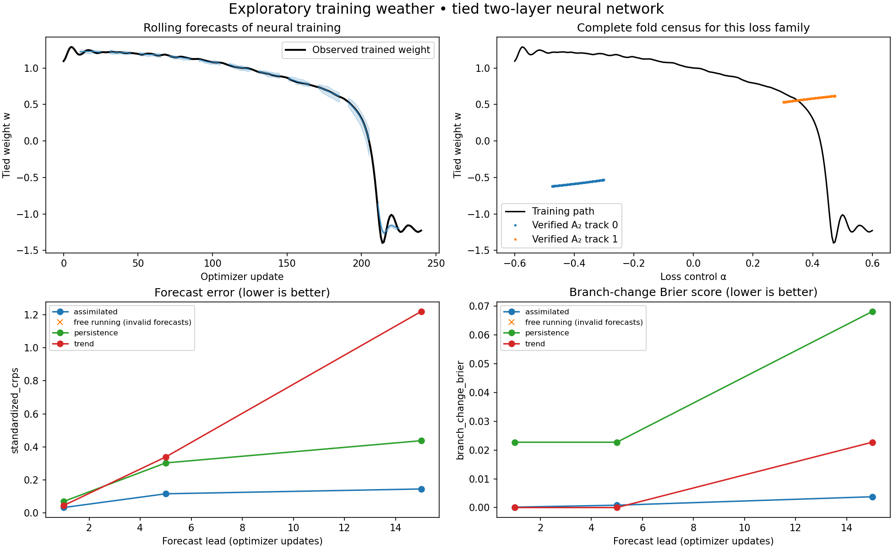

# Weather-inspired neural training forecasts and A₂ fold tracking

**Status:** COMPLETED exploratory calibration; not a TinyLLM result  
**Study:** `training-weather-a2-v1`  
**Classification:** `exploratory_calibration_with_forecast_failures`  
**Artifact root:** `data/experiments/training_weather/20261005_exploratory_cuda_v1/`  
**Aggregate SHA-256:** `0db91b69b7fb2e09b236429e827aa4b51f96f2ec6a36a0de79e057f9c67889fb`  
**Scientific fingerprint:** `c0e251099ed2ec7d89da2dce036858b4c8c0ac51c23168d671fa17694a7c356c`

## Outcome

An ensemble surrogate with sequential Kalman updates forecast the weights of a
small neural network more accurately than persistence and recent-trend
extrapolation at 1, 5, and 15 optimizer updates. Both A₂ fold branches of this
network's population loss were exhaustively enumerated and verified at all
241 checkpoints: **482 fold records, representing two moving branches**, not
482 different catastrophes.

The uncorrected ensemble diverged on two of six test trajectories. Those failed
forecasts remain in the record; its aggregate scores are null rather than
averages over successful survivors. The corrected forecast had no invalid
records, but its nominal 90% intervals covered only 86.9% at 15 updates.



## What was implemented

- [Forecast engine](../../../experiments/structure_net/training_weather.py): a
  controlled polynomial model of state increments, bootstrap uncertainty across
  independent seed groups, residual process noise, stochastic ensemble Kalman
  assimilation, rolling forecasts, CRPS, interval coverage, and Brier scoring.
- [Fold detector](../../../experiments/structure_net/a2_training_folds.py): augmented
  stationary-point/root equations, full Hessian and third-derivative tests,
  control transversality, deduplication, and temporal association with ambiguity
  reporting. A stateless adapter accepts smooth PyTorch network losses.
- [Executable calibration](../../../experiments/structure_net/training_weather_demo.py):
  actual SGD on a tied two-layer network, immutable artifacts, checkpoint replay,
  fold census, held-out verification, and PNG/SVG plots.

The design and method sources are in
[training-weather.md](../../01%20-%20Design/training-weather/training-weather.md). The weather analogy
is operational: forecast an ensemble, incorporate current observations, then
score forecasts against later observations. No fluid-dynamics equation is
imposed on SGD.

## Model and complete fold set

Two tied linear layers produce `w*w*x`, with an independent transverse output
`b`. For inputs `x=1`, the controlled population loss is

\[
L(w,b;\alpha,q)=\frac14(w^2-q)^2+\frac12b^2+\alpha w.
\]

The control `alpha` is the coefficient of a deliberately chosen linear
regularizer. The regression target `q` varies smoothly from 0.85 to 1.15 over
training. Learning rate is a separate optimizer setting.

Stationarity requires `b=0` and `w^3-q*w+alpha=0`. The Hessian is
`diag(3*w*w-q, 1)`. Consequently the full fold set is

\[
w_\pm=\pm\sqrt{q/3},\qquad b=0,\qquad
\alpha_\pm=q w_\pm-w_\pm^3.
\]

There are no other Hessian-null stationary points for `q>0`. At each fold the
transverse eigenvalue is 1, the cubic derivative along the null mode is `6*w`,
and the control coupling is 1. Thus each is a minimum/index-one-saddle A₂ fold.
This is an analytic completeness proof for the **population-loss family**;
every checkpoint's numerical derivative tests independently passed.

- Maximum stationary-gradient residual: `1.11e-16`.
- Minimum absolute null-direction cubic: `3.19374`.
- Both track identities persisted across all checkpoints without ambiguity.
- Independent multistart searches at initial, middle, and final target values
  recovered both analytically known folds.
- Fold catalogue SHA-256:
  `8cf19f38ffd5133b28ed3b144d2b7e9d098d9e14d004a610d6ceacba22955309`.

For a general network, `find_folds` reports verified candidates and search
diagnostics, with `completeness="unverified_multistart_search"`. A finite set of
root-solving seeds does not establish that every fold was found. The default
dense-Hessian budget is 32 parameters; large-network exhaustive tracking,
nonsmooth losses, and symmetry-induced multiple zero modes remain unresolved.

## Forecast results

Training used GPU 2, an RTX 2060 SUPER, through outside-sandbox execution. The
sandbox did not expose CUDA devices; the host did. PyTorch was `2.5.1+cu121`.
The numerical surrogate and small dense fold solves ran on CPU.

There were six fitting seeds and three held-out seeds. Each seed had rising
and falling control schedules, yielding 12 fitting and 6 test trajectories.
Schedules within a seed share random streams and are paired; they do not count
as independent seeds. Bootstrap resampling retained these pairs together.
Each model trained for 240 updates with SGD momentum 0.8 and learning rate 0.08.
The ensemble contained 32 members.

There were 264 forecasts per arm and horizon (44 per test trajectory). The
following RMSE standardizes each weight coordinate using fit-run statistics
and takes the square root of the mean squared endpoint errors.

| Lead, updates | Assimilated RMSE | Persistence RMSE | Trend RMSE | Assimilated 90% coverage |
| ---: | ---: | ---: | ---: | ---: |
| 1 | 0.06776 | 0.11989 | 0.07892 | 91.1% |
| 5 | 0.26461 | 0.50700 | 0.62188 | 88.1% |
| 15 | 0.33276 | 0.72241 | 2.09230 | 86.9% |

| Lead, updates | Assimilated CRPS | Persistence CRPS | Trend CRPS | Assimilated Brier | Persistence Brier | Trend Brier |
| ---: | ---: | ---: | ---: | ---: | ---: | ---: |
| 1 | 0.03238 | 0.06909 | 0.04452 | 0.000144 | 0.022727 | 0 |
| 5 | 0.11582 | 0.30283 | 0.33890 | 0.000818 | 0.022727 | 0 |
| 15 | 0.14493 | 0.43746 | 1.21990 | 0.003762 | 0.068182 | 0.022727 |

Lower RMSE, CRPS, and Brier scores are better. Deterministic baselines have
degenerate predictive distributions; their interval width and empirical
coverage here are zero. The recent-trend baseline had the best branch-event
Brier score at 1 and 5 updates, despite worse trajectory error.

The event is a sign change of `w` within the forecast window. It is distinct
from the stationary-landscape A₂ test: SGD can overshoot and switch after the
landscape fold has passed. All six test trajectories changed sign between
updates 205 and 206. There were only six event-positive windows at leads 1 and
5, and 18 at lead 15. This is a narrow, known-schedule calibration and cannot
establish robust prediction of heterogeneous or unforeseen catastrophes.

| Held-out trajectory | Assimilated 15-update RMSE | Assimilated CRPS | Invalid free-running forecasts at lead 15 |
| --- | ---: | ---: | ---: |
| rising / 101 | 0.31662 | 0.14189 | 0/44 |
| rising / 131 | 0.29779 | 0.13128 | 0/44 |
| rising / 167 | 0.37012 | 0.16038 | 44/44 |
| falling / 101 | 0.33330 | 0.14372 | 0/44 |
| falling / 131 | 0.28733 | 0.12769 | 0/44 |
| falling / 167 | 0.38054 | 0.16461 | 44/44 |

There were 3,168 arm/horizon forecast records, including 264 invalid records
from the free-running arm. No failed members or origins were silently removed.
Observed-state filtering prevented this numerical divergence in the tested
corrected arm; it does not prove global stability of the fitted surrogate.

## Validation and provenance

All 18 focused tests passed. They cover controlled-dynamics recovery, CRPS
against its direct definition, partial observations, future-observation
isolation, independent forecast RNG streams, held-out seed-group separation,
model persistence, strict JSON, checkpoint replay, and numerical failures.
Fold tests reject cusps, zero unfolding coupling, multiple null modes, and the
wrong saddle index. An independent polynomial-root test verifies annihilation
of a minimum and saddle on opposite sides of a fold. A PyTorch adapter test
checks derivatives without mutating the source network.

The first CUDA lifecycle root, `20261005_shakedown_cuda_v1`, is retained as a
failed execution after free-running forecast overflow. The revised
`20261005_shakedown_cuda_v2` completed with explicit invalid-forecast reporting.
Neither shakedown is included in these quality measurements. The evaluator
amendment is documented in the design; no model hyperparameters were tuned in
response. Producing source/configuration copies and hashes are in each root.
All full-pilot source hashes matched the working files on final inspection.

## Reproduce and reuse

From the repository root, run the focused checks:

```bash
env LD_LIBRARY_PATH= MPLCONFIGDIR=/tmp/structure-net-matplotlib \
  OPENBLAS_NUM_THREADS=1 .pixi/envs/default/bin/python -m pytest \
  tests/structure_net/test_training_weather.py \
  tests/structure_net/test_a2_training_folds.py -q
```

Run a new pilot with a **new** output directory. On this host CUDA must be
accessible outside the sandbox. Physical GPU 2 becomes logical `cuda:0`:

```bash
env LD_LIBRARY_PATH= CUDA_DEVICE_ORDER=PCI_BUS_ID CUDA_VISIBLE_DEVICES=2 \
  MPLCONFIGDIR=/tmp/structure-net-matplotlib OPENBLAS_NUM_THREADS=1 \
  .pixi/envs/default/bin/python -m experiments.structure_net.training_weather_demo \
  --device cuda:0 --output data/experiments/training_weather/NEW_RUN
```

For a different model, use `TrainingTrace.from_csv(path, state_fields,
control_fields)`, then `TrainingWeather.fit`, `initialize`, `advance`,
`assimilate`, and `forecast`. CSV rows must have a `step` field and regular
spacing. Only pass future controls actually known at issue time. Assign a
shared `group_id` to correlated trajectories before fitting. Scaling,
coefficients, and covariance must be learned on separate fitting runs.
The included `hindcast` event score specifically means a sign change in state
field zero; a different application needs its own declared event definition.

For folds of a smooth PyTorch network, `network_loss_adapter` constructs
`L(theta,alpha)=data_loss+alpha*control_penalty` from an unmodified model copy.
Pass that loss, initial guesses, and explicit parameter/control bounds to
`find_folds`, then feed verified records to `FoldTracker`. Defining the loss
family and checking search completeness remain separate obligations. Full
TinyLLM training forecasts and exhaustive full-network fold tracking have
**not** been demonstrated by this calibration.
