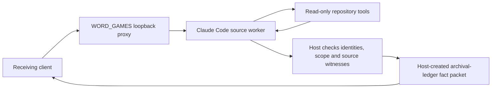

# Claude Code behind the WORD_GAMES research proxy

Completed exploratory study `word-games-claude-research-thread-v1`:
`completed_bounded_research_channel_partial_coverage`.

A real Claude Code worker answered sixteen dependent StructureNet research turns
through WORD_GAMES. One native conversation ID was preserved across all calls.
The receiving client obtained **30/36 authorized facts**, with **11/11 delayed
recall facts** recovered without further source reads. The worker's reported model
was `claude-sonnet-5-5`; it used the existing Claude subscription login.
Four subsequent natural-language questions brought the same conversation to
**20 turns**, including two bridge restarts. The interactive proxy remains ready.

The implemented path is:



The bridge sits between the client and worker. Claude Code uses its ordinary
underlying provider connection. This experiment does not replace its model API
endpoint with the bridge, or route the worker through the central LiteLLM proxy.

## What the channel conveyed

The approved packets covered StructureNet's purpose and retained legacy stack;
component interfaces and measurement/action boundaries; NAL scheduling and
resume semantics; experiment methodology; the TinyLLM competence failure;
NCM summary and released-checkpoint results; normal WORD_GAMES retrieval
limitations; V3 integration boundaries; and the golf/poker result.

Examples actually received through the channel include:

- StructureNet studies sparse neural-network construction, measurement and
  structural evolution. The legacy evolution implementation remains present.
- The local NAL scheduler distributes independent experiments across logical
  CUDA slots. Resuming successful results does not generally restore partial
  training or optimizer state.
- Native-2048 TinyLLM completed 12,000 updates and 73,728,000 target tokens,
  failed its competence gate at 8.70% degradation, and did not run H2 evaluation.
- The latest completed NCM development summary grade was 0/128 under Terra;
  paraphrases were allowed. Native Sudoku results were 99.4% easy and 86.3% hard.
- The normal WORD_GAMES sender made zero model-selected retrieval calls, and
  the golf proxy throughput used reference-token counts rather than native usage.

These are **catalog coverage and retrieval results**, not an independent model
accuracy score. The host preauthorizes 36 canonical facts and supplies the released
wording and values. The worker receives fact questions, identifiers and source
locations, but not those canonical answers or required witness anchors. It reads
the repository, selects facts and supplies literal evidence. This tests a bounded
fact channel, not the full range of what Claude knows about StructureNet.

## Measurements

| Measurement | Result |
| --- | ---: |
| Completed conversational turns | 16/16 |
| Native Claude session identities | 1 |
| Unique approved facts received | 30/36 (83.3% catalog coverage) |
| Accepted citations, including repeated facts | 51/58 |
| Rejected citations | 7, affecting 6 distinct facts |
| Delayed recall facts received | 11/11 |
| Source reads in those three recall turns | 0 |
| Repository tool calls | 13 Read + 4 Grep |
| Structured-output calls | 16 |
| Client round-trip time | 109.405 seconds |
| Worker time within those requests | 106.618 seconds |
| Worker-reported native output tokens | 11,385 |
| Native worker output / client seconds | 104.06 tokens/s |
| Public compact-packet reference tokens | 3,712 |
| Public reference tokens / client seconds | 33.93 token-equivalents/s |

Native output usage includes tool/structured generation across the worker's
internal model calls, not just final human-readable text. Public packet counts
use the local Qwen tokenizer and compact JSON serialization. The two token units
must not be divided to claim a compression ratio. Timings include worker launch,
provider requests, file tools and bridge work; they are not isolated decode
benchmarks. The one-time Qwen metaphor-selection call precedes these sixteen
timed queries and is excluded from their aggregate.

Claude reported 90 uncached input tokens, 42,252 cache-creation input tokens and
632,969 cache-read input tokens across its internal calls. Cache reads reflect
repeated context use, not that many unique repository tokens. This is a different
model, client and caching path from the preceding Sol/LiteLLM experiment, so its
higher observed throughput is not a matched bridge-speed improvement.

## Where information was withheld

Every source turn returned a valid structured proposal and the expected native
session ID. Seven citations failed the host's fixed per-fact witness check. The
missing identities were F02, F04, F12, F14, F28 and F30; F28 was rejected twice.

Some quotes were alternate correct passages, notably the preferred-coordination
table row and an append-only instruction elsewhere in the guide. Others omitted
details required by the host's compound canonical fact, such as the sibling-package
relationship or the exact measured count. This reveals both overly narrow witness
matching and incomplete citation selection. It does not show that the worker
failed to know all six facts. The rejected evidence was preserved and no answers
were retried, repaired or counted as delivered. A future change should use explicit
alternative witnesses or more atomic facts, with a new profile version.

## Boundary and persistence

Qwen chose the `archival ledger` metaphor from public task structure before any
private source material entered its selection prompt. The host validates its key
bijection. Approved project names and semantic values remain literal payloads;
keys and finding/evidence identities form the translated view. The new research
profile follows WORD_GAMES' proposal → validation → authorized projection pattern.
It does not invoke the V3 placement Engine or implement V4 recursive capsules.

The host never forwards worker-authored prose, quotes, source paths or arbitrary
unknown strings. All sixteen packets lacked the synthetic private marker and
matched the host-approved projections exactly. Seven prelaunch tests covered
projection, scope, identities, invented evidence, extra fields and mapping
roundtrip. Post-run HTTP controls returned generic 400/404 errors for attempts
to request raw/private output, without starting another worker turn.

This is a logical message boundary within a trusted local harness. The receiving
test process is not an independently sandboxed adversary, and this is not a proof
against covert channels or arbitrary free-text leakage. File reads on the worker
were restricted; Bash, edits, web access, external MCP servers and worker
subagents were absent. Raw source transcripts remain private experiment evidence.

The loopback service remains ready at `http://127.0.0.1:18091`, with no generation
while idle. Its original Q01–Q16 benchmark is preserved. Versioned continuation
now accepts natural-language questions within the same authorized catalog and
retains session `b19113d9-d628-4eb4-906f-30bb5ed04006`. It writes an append-only
checkpoint after each completed turn; restarting from the latest checkpoint
preserves the conversation, mapping and released-fact identities. A failed
terminal record blocks automatic resume rather than silently skipping a turn.

Q17–Q20 asked about workflow readiness, the NCM grade, workflow failures and NAL
scheduling. They released 13 repeated facts, with four rejected citations, using
only StructuredOutput and no additional file reads. These four development turns
are separate from the frozen benchmark above. Q19 explicitly identified a withheld
fact in the public `unknown` field; this behavior was added after Q17. The
continuation audit checked the checkpoint chain, source snapshots, citations,
canonical packet equality and native session. Repeating Q20 returned HTTP 400
without advancing the conversation. Nine focused tests passed after the
persistence and source-snapshot fixes.

The current server artifacts are under
`data/experiments/word_games/20261101_claude_research_bridge_continuation_v3`.
Send another question from the repository root:

```sh
pixi run python -m experiments.word_games.ask_claude_research_bridge --topic all --question 'What evidence do we have about NCM summarization quality?' --output data/experiments/word_games/NEW_RESEARCH_QUESTION
```

The client obtains the next query ID and mapping from the bridge. Use a fresh
output directory. Topics are `architecture`, `contracts`, `scheduler`, `science`,
`tinyllm`, `ncm`, `pretrained`, `wordgames`, `v3`, `golf`, or `all`. Responses remain
canonical approved facts, not unrestricted free-form worker answers. When the
current server is stopped, resume it in a fresh server directory:

```sh
pixi run python -m experiments.word_games.claude_research_bridge --resume-from data/experiments/word_games/20261101_claude_research_bridge_continuation_v3 --output data/experiments/word_games/NEW_RESEARCH_CONTINUATION
```

Claude Code's documented print/structured-output and resume facilities provide
the worker transport; the installed CLI's restricted/safe-mode flags were checked
before use. [Official programmatic-use documentation](https://code.claude.com/docs/en/headless),
[CLI reference](https://code.claude.com/docs/en/cli-reference).

## Evidence and reproduction

- Source bridge: `data/experiments/word_games/20261101_claude_research_bridge_v1`.
- Receiver-only transcript: `data/experiments/word_games/20261101_claude_research_thread_client_v1`.
- Readable receiver-only facts: `data/experiments/word_games/20261101_claude_research_thread_client_v1/authorized_knowledge.txt`.
- Independent audit: `data/experiments/word_games/20261101_claude_research_thread_audit_v3`.
- Continuation audit: `data/experiments/word_games/20261101_claude_research_continuation_audit.json`.
- Source result SHA256:
  `653f52d5d8838bf08c8dbd8abec6a5c0c130831aac3043e48d708802f77f762c`.
- Audit SHA256:
  `432e6ec2d98c22bb0e0440ba60f911b887e6f8ed37f5554453161b205d5bdacc`.

The independent audit verified source hashes, all session IDs and actual tool
calls, every accepted citation and public packet, receiver receipt equality and
all public token counts. The first auditor version incorrectly retokenized
artifact-sorted JSON rather than the producer's insertion-ordered compact JSON.
Its failure receipt remains preserved; the corrected auditor reconstructs the
exact original serialization. Model responses and measurements were unchanged.

A subsequent persistence audit found that the producer's absolute main-script
path defeated the original snapshot-directory join. Its prelaunch hash was
recorded, but the main script was not durably copied into the first three server
roots. Those exact versions were reconstructed from the recorded edits, matched
against their respective prelaunch SHA256 values, and saved with explicit
`source_snapshot_recovery.json` receipts. These three recovered main-script
copies are post-run reconstructions, not contemporaneous snapshots. Other source
copies and all model logs/results were preserved. The current continuation
normalizes paths before copying and captured its main script before inference;
audit v3 checks the normalized snapshots rather than the live source path.

Run from repository root with Pixi and fresh directories/unused ports:

```sh
pixi run pytest tests/word_games/test_research_profile.py -q
pixi run python -m experiments.word_games.claude_research_bridge --port 18092 --output data/experiments/word_games/NEW_RESEARCH_BRIDGE
pixi run python -m experiments.word_games.run_claude_research_thread --url http://127.0.0.1:18092 --output data/experiments/word_games/NEW_RESEARCH_CLIENT
pixi run python -m experiments.word_games.audit_claude_research_thread --root data/experiments/word_games/NEW_RESEARCH_BRIDGE --client data/experiments/word_games/NEW_RESEARCH_CLIENT --output data/experiments/word_games/NEW_RESEARCH_AUDIT
```

Start the server and client in separate terminals. The existing Claude subscription
login and local Qwen selector/tokenizer are required. No global Claude settings or
GPU serving configurations were changed.
