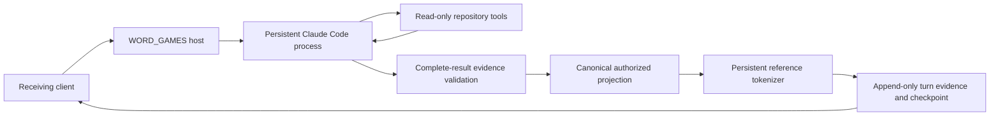

# WORD_GAMES: persistent worker environment reduces host overhead

Completed exploratory study `word-games-rlm-overhead-v1`.
Classification: `persistent_transport_boundary_and_coverage_pass`.
The optimized transport is deployed on the existing loopback research bridge.

The matched sixteen-turn comparison took **116.064 seconds** with a new Claude
process per request and **87.469 seconds** with a persistent process: **24.64%
less elapsed time**, or 1.327× throughput for completing this question sequence.
Estimated time outside CLI-reported provider calls fell from **16.404 seconds to
1.452 seconds**, a **91.15% reduction**. Both arms recalled all eleven delayed
facts without rereading sources. The persistent arm released 31/36 catalog facts;
the fresh baseline released 29/36. Every baseline fact was also delivered by the
persistent arm. These are retrieval-coverage observations, not model accuracy.

Comparison result:
`data/experiments/word_games/20261101_rlm_environment_comparison_v1/result.json`

SHA256: `366aacaf0d2b448eca591a3a4e99fae105a5257045583c2e50fb857f1f5bba43`.

## Scope and changes

This optimizes the execution environment around the current bounded Claude Code
research worker. It does not install a general recursive REPL, V4 capsules or a
new reasoning algorithm. The separate local placement/sender/receiver workflow
and the GPU serving configuration were not changed.

Previously each turn started Claude Code, loaded its saved conversation, waited
for a result and exited. Each packet token count also launched Docker exec and
a Python interpreter. The new path keeps one sequential Claude stream-JSON
process and one read-only tokenizer process alive across requests.



The native conversation, model alias, system prompt, fact menu, output schema,
source witnesses and public mapping remain the same. No answer cache is used.
Partial model output stays private; only the completed validated projection is
released. EOF, timeout, malformed framing, missing structured output or changed
session identity stops the transport without automatic request replay.

Per-turn timing now separates worker execution, validation, tokenization and
checkpoint work. Mutable process diagnostic streams are excluded from immutable
checkpoint hashes; their current bytes are separately captured in each turn.
Graceful service shutdown closes both child processes. The installed Claude CLI
supports streaming input/output; the subscription login and restricted read-only
tool configuration are preserved. [Official CLI reference](https://code.claude.com/docs/en/cli-reference).

## Measurements and limits

The comparison used two fresh native sessions of reported model
`claude-sonnet-5-5`, each answering the same sixteen questions. Which arm ran
first alternated by question. All prompts matched byte-for-byte between arms;
both used the previously frozen archival-ledger mapping. The first process
startup is included. Mapping selection was not repeated or timed.

| Measurement | Process per request | Persistent processes |
| --- | ---: | ---: |
| Total timed processing | 116.064 s | 87.469 s |
| CLI-reported provider-call time | 99.660 s | 86.017 s |
| Time outside provider calls | 16.404 s | 1.452 s |
| Warm mean time outside provider calls, turns 2–16 | 1.030 s/turn | 0.038 s/turn |
| Tokenization time within comparison | 2.637 s | 0.216 s |
| Evidence validation time | 0.0206 s | 0.0231 s |
| Unique authorized facts | 29/36 | 31/36 |
| Delayed recall | 11/11 | 11/11 |
| Source reads during delayed recall | 0 | 0 |
| Rejected citations | 8 | 6 |
| Native worker output tokens | 12,564 | 10,962 |
| Public Qwen-reference tokens | 3,654 | 3,768 |
| Public reference tokens / total processing time | 31.48/s | 43.08/s |

The CLI provider-duration field is cumulative over a conversation; we difference
successive values, rather than incorrectly summing cumulative totals. The
outside-provider estimate is wall time minus those reported intervals. It
includes SDK/host scheduling and instrumentation, not just Python CPU time.
Full comparison timing includes result validation, tokenization and per-turn
evidence writes. It excludes HTTP dispatch and the deployed bridge's cumulative
checkpoint hashing; those are measured separately in the deployment checks.

**The entire 24.64% elapsed-time reduction is not attributable to transport.**
Outside-provider savings account for 14.952 seconds of the 28.595-second gap.
The other 13.643 seconds came from different provider-call work/timing. In
particular, baseline Q11 made two StructuredOutput calls, while its counterpart
made one. Native output lengths also differed. This is one alternating paired
question sequence with dependent conversation turns, not independent replicated
cloud-latency trials. No population speedup or accuracy claim is established.

The public token rates use the same Qwen reference tokenizer and count only
released packets. They are not Claude decode speed or local GPU generation
speed. The extra two admitted facts also increase the persistent arm's public
token count. The older thread's 30/36 coverage is preserved as a separate run;
29/36 here is the newly executed baseline.

A tokenizer-only check used sixteen captured public packets plus empty, Unicode
and special-token-looking strings, with two passes and alternating arm order.
All **38/38 counts matched exactly**. Total time including first startup was
6.324 seconds versus 0.224 seconds (**28.26×**). Warm medians were **165.5 ms
versus 2.05 ms**. That multiplier applies to token counting, not the whole task.

The remaining time is mostly provider calls: 86.017 of 87.469 seconds in the
persistent comparison. Further substantial gains would need to reduce model
work or change the interaction protocol. Evidence validation was already around
one millisecond per turn and is preserved.

## Validation and deployment

Seventeen focused tests passed, covering process reuse, complete event capture,
EOF/malformed-output/timeouts, session identity rejection, projection and source
controls, duplicate queries, and immutable checkpoints despite growing live
diagnostics. A two-turn live lifecycle pilot passed before the full comparison.
Its first turn retrieved scheduler evidence and the second recalled all three
facts from the same process and session.

The independent comparison audit checked all artifact/source hashes, native
session identities, actual tool calls, complete-result proposals, accepted
literal evidence, canonical projections and exact public-token recounts.
No private marker or arbitrary worker prose entered the released packets.
The fresh coverage/recall gate passed; the persistent arm delivered a strict
superset of the baseline facts. This remains the same 36-fact logical disclosure
boundary, not a proof against covert channels or an adversarial OS-level reader.

The original conversation was resumed from its preserved Q20 checkpoint, then
answered Q21 (scheduler) and Q22 (NCM grading). It returned all **7/7 requested
facts**, with zero source reads or rejected citations. Both turns used one worker
PID and session `b19113d9-d628-4eb4-906f-30bb5ed04006`. Client times were 4.845 and
4.027 seconds, including the first persistent process start on Q21. A duplicate
Q22 was rejected without another model call.

The bridge remains ready at `http://127.0.0.1:18091`, with no generation while
idle. Current evidence root:
`data/experiments/word_games/20261101_rlm_environment_deployed_v1`.
Requests use the existing client:

```sh
pixi run python -m experiments.word_games.ask_claude_research_bridge --topic all --question 'What does our NCM evidence establish?' --output data/experiments/word_games/NEW_RESEARCH_QUESTION
```

After stopping the server, preserve the conversation in a fresh artifact root:

```sh
pixi run python -m experiments.word_games.claude_research_bridge --resume-from data/experiments/word_games/20261101_rlm_environment_deployed_v1 --output data/experiments/word_games/NEW_RESEARCH_SERVER
```

Persistent processes are now the default. `--one-shot-workers` explicitly selects
the earlier lifecycle. It does not fall back automatically after a failed call.

## Evidence and reproduction

- Plan: [worker environment protocol](../../07%20-%20Status%20Reports/word-games/2026-11-01_word-games-rlm-overhead-plan.md).
- Lifecycle pilot: `data/experiments/word_games/20261101_rlm_environment_pilot_v1`.
- Matched comparison: `data/experiments/word_games/20261101_rlm_environment_comparison_v1`.
- Independent audit: `data/experiments/word_games/20261101_rlm_environment_audit_v1/audit.json`.
- Audit SHA256: `f03d11ba08a1a59c49aecf157a72a5e81a9e7ea73e468b597d9dbc80ecbeaa4b`.
- Tokenizer comparison: `data/experiments/word_games/20261101_rlm_tokenizer_v1/result.json`.
- Deployment audit: `data/experiments/word_games/20261101_rlm_environment_deployment_audit_v1.json`.

Use Pixi from repository root and fresh artifact directories:

```sh
pixi run pytest tests/word_games/test_worker_environment.py tests/word_games/test_research_profile.py -q
pixi run python -m experiments.word_games.benchmark_worker_environment --stage pilot --output data/experiments/word_games/NEW_ENV_PILOT
pixi run python -m experiments.word_games.benchmark_worker_environment --stage full --output data/experiments/word_games/NEW_ENV_COMPARISON
pixi run python -m experiments.word_games.audit_worker_environment --root data/experiments/word_games/NEW_ENV_COMPARISON --output data/experiments/word_games/NEW_ENV_AUDIT
pixi run python -m experiments.word_games.benchmark_reference_tokenizer --output data/experiments/word_games/NEW_TOKENIZER_COMPARISON
```
